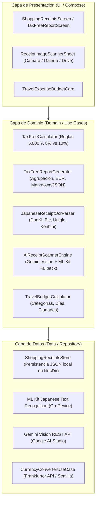

# Análisis Técnico: Módulo de Tickets de Compra, Tax-Free y Control de Gastos (SPEC-08)

- **ID**: `ANALYSIS-08`
- **Especificación de Referencia**: [`SPEC-08`](../specs/08-shopping-receipts-tax-free-spec.md)
- **Estado**: `Aprobado para Implementación TDD`
- **Módulo**: `com.laralbir.japantraveltools.feature.taxfree`

---

## 1. Arquitectura del Módulo (Clean Architecture)

El módulo se estructura conforme a los principios de Clean Architecture y la filosofía 100% Offline-First del proyecto:



---

## 2. Contratos y Modelos de Dominio

### 2.1. Modelos Principales (`ShoppingReceiptsModels.kt`)

```kotlin
package com.laralbir.japantraveltools.feature.taxfree

import java.time.Instant
import kotlinx.serialization.Serializable

enum class GoodsType {
    CONSUMABLES,    // Alimentos, bebidas, medicinas, cosméticos (Tasa reducida 8% habitual, salida en 30 días precintado)
    GENERAL_GOODS,  // Ropa, calzado, electrónica, recuerdos duraderos (Tasa general 10%, salida en 6 meses)
    MIXED           // Combinación de consumibles y bienes generales en el mismo ticket
}

enum class TaxFreeClaimStatus {
    NOT_APPLICABLE,   // No elegible (< 5.000 ¥)
    PENDING,          // Elegible, pendiente de aduana
    CUSTOMS_STAMPED,  // Sellado / registrado en aduana japonesa
    REFUNDED          // Reembolsado o descontado en tienda
}

enum class ExpenseCategory(val displayNameEs: String, val displayNameEn: String, val icon: String) {
    SHOPPING("Compras y Recuerdos", "Shopping & Souvenirs", "🛍️"),
    FOOD("Comida y Bebida", "Food & Dining", "🍜"),
    TRANSPORT("Transporte", "Transport", "🚆"),
    LEISURE("Ocio y Entradas", "Leisure & Activities", "⛩️"),
    ACCOMMODATION("Alojamiento", "Accommodation", "🏨"),
    OTHER("Otros Gastos", "Other", "🏷️")
}

@Serializable
data class ReceiptProductItem(
    val id: String,
    val name: String,
    val quantity: Int = 1,
    val unitPriceYen: Double,
    val taxRatePercent: Double = 10.0, // 8.0 o 10.0
    val subtotalWithoutTaxYen: Double = quantity * unitPriceYen,
    val taxYen: Double = Math.round(subtotalWithoutTaxYen * (taxRatePercent / 100.0)).toDouble(),
    val totalWithTaxYen: Double = subtotalWithoutTaxYen + taxYen
)

@Serializable
data class ShoppingReceipt(
    val id: String,
    val purchaseDateIso: String, // ISO UTC Instant (ej. 2027-03-20T05:30:00Z)
    val storeName: String,
    val location: String = "Tokyo",
    val items: List<ReceiptProductItem> = emptyList(),
    val subtotalWithoutTaxYen: Double = items.sumOf { it.subtotalWithoutTaxYen },
    val totalTaxYen: Double = items.sumOf { it.taxYen },
    val totalWithTaxYen: Double = items.sumOf { it.totalWithTaxYen },
    val isTaxFreeEligible: Boolean = subtotalWithoutTaxYen >= 5000.0,
    val goodsType: GoodsType = GoodsType.GENERAL_GOODS,
    val taxFreeStatus: TaxFreeClaimStatus = if (isTaxFreeEligible) TaxFreeClaimStatus.PENDING else TaxFreeClaimStatus.NOT_APPLICABLE,
    val category: ExpenseCategory = ExpenseCategory.SHOPPING,
    val photoFilePath: String? = null,
    val notes: String = "",
    val updatedAtMillis: Long = System.currentTimeMillis()
)
```

### 2.2. Modelos de Presupuesto y Control de Gastos

```kotlin
@Serializable
data class CategoryExpenseBreakdown(
    val category: ExpenseCategory,
    val totalYen: Double,
    val totalEur: Double,
    val percentageOfTotal: Double,
    val receiptCount: Int
)

@Serializable
data class DayExpenseBreakdown(
    val dateIso: String,
    val totalYen: Double,
    val totalEur: Double,
    val receiptCount: Int
)

@Serializable
data class CityExpenseBreakdown(
    val city: String,
    val totalYen: Double,
    val totalEur: Double,
    val receiptCount: Int
)

@Serializable
data class TravelBudgetSummary(
    val totalSpentYen: Double,
    val totalSpentEur: Double,
    val totalTaxFreeRecoverableYen: Double,
    val totalTaxFreeRecoverableEur: Double,
    val byCategory: List<CategoryExpenseBreakdown>,
    val byDay: List<DayExpenseBreakdown>,
    val byCity: List<CityExpenseBreakdown>,
    val exchangeRateUsed: Double
)
```

### 2.3. Modelos del Informe Tax-Free

```kotlin
@Serializable
data class TaxFreeStoreGroup(
    val storeName: String,
    val dateIso: String,
    val receiptCount: Int,
    val subtotalWithoutTaxYen: Double,
    val totalTaxYen: Double,
    val totalWithTaxYen: Double,
    val goodsType: GoodsType,
    val status: TaxFreeClaimStatus,
    val receipts: List<ShoppingReceipt>
)

@Serializable
data class TaxFreeReport(
    val generatedAtIso: String,
    val storeGroups: List<TaxFreeStoreGroup>,
    val totalReceiptsCount: Int,
    val totalSubtotalWithoutTaxYen: Double,
    val totalRecoverableTaxYen: Double,
    val totalRecoverableTaxEur: Double,
    val statusBreakdown: Map<TaxFreeClaimStatus, Int>,
    val exchangeRateUsed: Double,
    val textReport: String,
    val markdownReport: String,
    val jsonExport: String
)
```

---

## 3. Lógica del Parser OCR Japonés (`JapaneseReceiptOcrParser.kt`)

Los recibos emitidos en Japón siguen patrones estructurales específicos que el analizador identifica:
1. **Detección de Nombre de Cadena / Tienda**:
   - `ドン・キホーテ` / `DON QUIJOTE` -> Don Quijote
   - `ビックカメラ` / `BIC CAMERA` -> Bic Camera
   - `ヨドバシ` / `YODOBASHI` -> Yodobashi Camera
   - `ユニクロ` / `UNIQLO` -> Uniqlo
   - `セブン-イレブン` / `7-ELEVEN` -> 7-Eleven
   - `ファミリーマート` / `FamilyMart` -> FamilyMart
   - `ローソン` / `LAWSON` -> Lawson
2. **Detección de Fecha**:
   - Formatos occidentales: `YYYY/MM/DD`, `YYYY-MM-DD`, `YYYY年MM月DD日`.
   - Formatos de la Era Reiwa (R): `R06.03.15` / `R7/10/24` (donde año gregoriano = año Reiwa + 2018).
3. **Detección de Tasas y Totales**:
   - Palabras clave:
     * `合計` (Goukei — Total general)
     * `小計` (Shoukei — Subtotal)
     * `内消費税` / `消費税等` / `消費税` (Shouhizei — Impuesto sobre el consumo)
     * `10%対象` (Base imponible al 10%) / `10%消費税`
     * `8%対象` / `軽` / `※` (Base imponible al 8% reducida / Keigen Zeiritsu)
     * `免税` / `TAX FREE`
4. **Determinación del Tipo de Bienes**:
   - Si contiene alimentos/bebidas exclusivamente -> `CONSUMABLES`.
   - Si contiene ropa/electrónica exclusivamente -> `GENERAL_GOODS`.
   - Si combina ambos tipos o tasas 8% y 10% -> `MIXED`.

---

## 4. Estrategia Híbrida de Escaneo con IA (`AiReceiptScannerEngine.kt`)

```kotlin
sealed class ScannerSource {
    object GEMINI_CLOUD_VISION : ScannerSource()
    object LOCAL_MLKIT_OCR : ScannerSource()
}

data class ReceiptScanResult(
    val receipt: ShoppingReceipt,
    val rawText: String,
    val source: ScannerSource,
    val warning: String? = null
)
```

1. **Intento Cloud Multimodal con Gemini**:
   - Si `apiKey.isNotBlank()` y el dispositivo tiene conexión:
     - Se invoca la API `models/gemini-flash-lite-latest:generateContent` (o `gemini-1.5-flash`) enviando la imagen en base64 y un System Prompt especializado solicitando estructuración estricta en JSON según el esquema de `ShoppingReceipt`.
     - Si la respuesta es un JSON válido, se mapea directamente a `ShoppingReceipt` con `ScannerSource.GEMINI_CLOUD_VISION`.
2. **Fallback Automático Local**:
   - Si Gemini falla (timeout, sin red, cuota 429 o formato inválido):
     - Se procesa la imagen con **ML Kit Text Recognition Japanese** (`JapaneseTextRecognizer`).
     - Se entrega el bloque de texto crudo a `JapaneseReceiptOcrParser.parse(text)`.
     - Se genera el `ShoppingReceipt` con `ScannerSource.LOCAL_MLKIT_OCR`.

---

## 5. Estrategia de Persistencia (`ShoppingReceiptsStore.kt`)

1. **Almacenamiento Local**:
   - Archivo `shopping_receipts.json` en `Context.filesDir` (o directorio temporal en tests).
   - Manejo de concurrencia mediante `Mutex` de Kotlin Coroutines y reactividad con `StateFlow<List<ShoppingReceipt>>`.
2. **Operaciones CRUD**:
   - `getReceipts()`: Flujo reactivo ordenado por `purchaseDateIso` descendente.
   - `saveReceipt(receipt)`: Inserta o actualiza un ticket recalculando totales, elegibilidad Tax-Free y clasificación de bienes.
   - `deleteReceipt(receiptId)`: Elimina el ticket y borra la foto asociada en almacenamiento privado si existe.
   - `calculateBudgetSummary(eurToJpyRate)`: Genera el resumen presupuestario del viaje (`TravelBudgetSummary`).
   - `generateTaxFreeReport(eurToJpyRate)`: Genera el informe oficial consolidado de Tax-Free (`TaxFreeReport`).

---

## 6. Estrategia de Testing (TDD Estricto)

1. **Tests de Cálculos y Reglas Fiscales**:
   - Cálculo exacto de líneas al 8% y 10%.
   - Umbral de 5.000 ¥ (igual a 5.000 ¥ -> elegible; 4.999 ¥ -> no elegible).
   - Clasificación `CONSUMABLES`, `GENERAL_GOODS` y `MIXED`.
2. **Tests del Parser OCR Japonés**:
   - Recibo de Don Quijote (compras mixtas, alimentos al 8% y souvenirs al 10%).
   - Recibo de Bic Camera (electrónica al 10% con importe superior a 5.000 ¥).
   - Recibo de Uniqlo (ropa al 10% Tax-Free).
   - Recibo de 7-Eleven (snacks al 8% por debajo del umbral).
3. **Tests de Generación de Informes Tax-Free**:
   - Agrupación por tienda y fecha.
   - Conversión de impuestos a EUR según tasa de cambio.
   - Validación de salidas en formato Texto, Markdown y JSON.
4. **Tests de Control de Gastos y Presupuesto**:
   - Acumulados totales en ¥ y EUR.
   - Desglose por categorías, días y ciudades.
5. **Tests de Escáner IA / Fallback**:
   - Fallback graceful a ML Kit/Parser local cuando no hay clave o hay error en Gemini.
