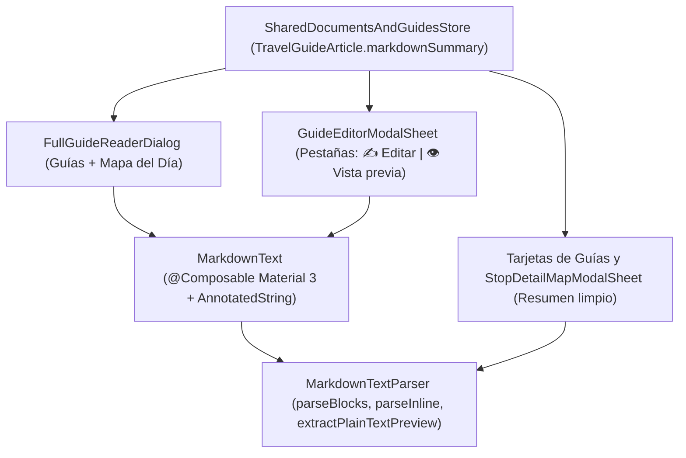

# Análisis Técnico 11: Renderizado Nativo de Markdown en Guías de Viaje y Vista Previa en Editor

- **ID**: `ANALYSIS-11`
- **Especificación**: [`SPEC-03 (RF-03.6)`](../specs/03-documents-and-id-vault-spec.md)
- **Componentes**: `feature.ai` (motor Markdown compartido), `feature.documents`, `feature.planner.map` y `ui.main`
- **Fecha**: 2026-11-07
- **Estado**: Aprobado

---

## 1. Contexto y Problema

Las Guías de Viaje (`TravelGuideArticle`) almacenan su contenido enriquecido en el campo `markdownSummary: String`, proveniente de tres flujos principales:
1. Guías importadas mediante paquetes JSON (`saved_travel_guides.json`, `japan-travel-plan.v1` o copias de seguridad de Google Drive).
2. Respuestas enriquecidas del Asistente IA Gemini / Experto Offline guardadas con un toque en la Bóveda de Guías.
3. Guías redactadas o editadas manualmente por el viajero en `GuideEditorModalSheet`.

Actualmente existen dos carencias principales:
1. **Texto plano sin procesar en Guías**: Tanto el lector a pantalla completa (`FullGuideReaderDialog` en `MainScreen.kt`), como las tarjetas de resumen del listado de Guías (`MainScreen.kt`) y las fichas de guías vinculadas del Mapa del Día (`StopDetailMapModalSheet.kt`) utilizan `Text(...)` plano, mostrando en pantalla almohadillas (`##`), asteriscos (`**`), guiones (`---`), barras de tabla (`|`) y casillas (`- [ ]`) en crudo.
2. **Cobertura parcial del parser existente**: `MarkdownTextParser` y `MarkdownTextRenderer` (`TASK-120`) cubren encabezados básicos, negritas, cursivas, listas planas y bloques de código, pero carecen de soporte para **tablas Markdown (`|...|`)**, **bloques de cita/aviso (`>`)**, **separadores horizontales (`---`)**, **casillas de verificación (`- [ ]` / `- [x]`)**, **sublistas indentadas multinivel**, **enlaces (`[texto](url)`)** y **extracción de resúmenes limpios** sin sintaxis cruda. Además, `GuideEditorModalSheet` no dispone de una pestaña de **Vista previa** para comprobar el resultado visual antes de guardar.

---

## 2. Arquitectura de la Solución (Clean Architecture + UDF)



### 2.1 Modelo de Dominio y Parser (`MarkdownTextParser.kt`)

Se amplía la jerarquía sellada `MarkdownBlock` y el modelo `InlineSpan` manteniendo compatibilidad total con el Asistente IA (`SPEC-06 RF-06.4`) y cero dependencias externas pesadas (100% offline-first):

```kotlin
sealed interface MarkdownBlock {
    data class Header(val level: Int, val text: String) : MarkdownBlock
    data class BulletItem(val text: String, val level: Int = 0) : MarkdownBlock
    data class NumberedItem(val number: Int, val text: String, val level: Int = 0) : MarkdownBlock
    data class TaskListItem(val isChecked: Boolean, val text: String, val level: Int = 0) : MarkdownBlock
    data class Blockquote(val text: String) : MarkdownBlock
    data object HorizontalRule : MarkdownBlock
    data class Table(val headers: List<String>, val rows: List<List<String>>) : MarkdownBlock
    data class CodeBlock(val code: String, val language: String? = null) : MarkdownBlock
    data class Paragraph(val text: String) : MarkdownBlock
}

data class InlineSpan(
    val text: String,
    val isBold: Boolean = false,
    val isItalic: Boolean = false,
    val isCode: Boolean = false,
    val linkUrl: String? = null
)
```

#### Reglas de Tokenización en `MarkdownTextParser`:
1. **Encabezados (`H1`–`H6`)**: `^(#{1,6})\s+(.*)$` mapeando `level` en `1..6`.
2. **Separadores horizontales (`HorizontalRule`)**: Líneas cuyo contenido recortado coincida con `^(?:-{3,}|\*{3,}|_{3,})$` (evaluado antes que viñetas para evitar falsos positivos).
3. **Casillas de tareas (`TaskListItem`)**: Líneas con sangrado opcional `^(\s*)(?:[-*•])\s+\[([ xX])\]\s+(.*)$`, calculando `level = indentSpaces / 2` (tabulador = 2 espacios) e `isChecked = marker.equals("x", ignoreCase = true)`.
4. **Listas con viñetas y sublistas indentadas (`BulletItem`)**: `^(\s*)(?:[-*•])\s+(.*)$` con cálculo de `level = indentSpaces / 2`.
5. **Listas numeradas (`NumberedItem`)**: `^(\s*)(\d+)\.\s+(.*)$` preservando número e indentación `level`.
6. **Citas / Avisos (`Blockquote`)**: Líneas consecutivas iniciadas por `^\s*>\s?(.*)$` agrupadas en un bloque `Blockquote` con saltos de línea limpios.
7. **Tablas Markdown (`Table`)**:
   - Detección de una fila de cabecera con barras `|` seguida inmediatamente de una fila separadora válida (`^\s*\|?(?:\s*:?-{3,}:?\s*\|)+\s*:?-{3,}:?\s*\|?\s*$`).
   - Extracción de celdas dividiendo por `|` (ignorando bordes exteriores vacíos) y lectura de todas las filas consecutivas con `|` para poblar `rows`, normalizando el número de columnas respecto a `headers`.
8. **Elementos inline (`parseInline`)**:
   - Reconocimiento ordenado de:
     - Código inline: `` `([^`]+)` ``
     - Enlaces: `\[([^\]]+)\]\(([^)\s]+)\)` -> `InlineSpan(text = label, linkUrl = url)`
     - Negrita + cursiva combinadas: `\*\*\*([^*]+)\*\*\*` o `___([^_]+)___` -> `isBold = true, isItalic = true`
     - Negrita: `\*\*([^*]+)\*\*` o `__([^_]+)__` -> `isBold = true`
     - Cursiva: `\*([^*]+)\*` o `_([^_]+)_` -> `isItalic = true`
9. **Extractor de Resumen Limpio (`extractPlainTextPreview`)**:
   - Firma: `fun extractPlainTextPreview(rawMarkdown: String, maxChars: Int = 180): String`
   - Descarta bloques de código cercados, reglas horizontales y filas separadoras de tablas (`|---|`).
   - Sustituye sintaxis de bloque (`#`, `>`, `- [ ]`, `- [x]`, viñetas `-`/`*`/`•`), reemplaza `[texto](url)` por `texto`, elimina delimitadores inline (`***`, `**`, `__`, `*`, `_`, `` ` ``), convierte separadores de celdas `|` en ` · ` y une las primeras líneas con sentido hasta `maxChars` con elipsis limpia (`…`) si se trunca.

---

### 2.2 Renderizador Compose Material 3 (`MarkdownTextRenderer.kt`)

Se actualiza `@Composable fun MarkdownText(...)` añadiendo parámetros opcionales con valores por defecto retrocompatibles:

```kotlin
@Composable
fun MarkdownText(
    markdown: String,
    modifier: Modifier = Modifier,
    textColor: Color = MaterialTheme.colorScheme.onSurface,
    baseFontSize: TextUnit = 14.5.sp,
    baseLineHeight: TextUnit = 21.sp
)
```

- **`Header` (`1..6`)**: Escala progresiva desde `H1` (`baseFontSize + 5.sp`, `FontWeight.Bold`, `MaterialTheme.colorScheme.primary`) hasta `H6` (`baseFontSize - 0.5.sp`, `FontWeight.SemiBold`, `MaterialTheme.colorScheme.onSurfaceVariant`).
- **`BulletItem` y `NumberedItem`**: Sangrado izquierdo dinámico `(block.level * 14).dp` y glifo diferenciado por nivel (`•`, `◦`, `▪`).
- **`TaskListItem`**: Sangrado dinámico `(block.level * 14).dp`, indicador visual claro (`☑️` cuando `isChecked == true`, `☐` cuando `false`) y formato inline completo.
- **`Blockquote`**: Contenedor con barra vertical izquierda de `3.dp` en `MaterialTheme.colorScheme.primary`, fondo `MaterialTheme.colorScheme.surfaceVariant.copy(alpha = 0.45f)` y esquinas redondeadas.
- **`HorizontalRule`**: `HorizontalDivider` con margen vertical equilibrado y opacidad suave (`outlineVariant.copy(alpha = 0.6f)`).
- **`Table`**: Contenedor `Surface` con borde `1.dp` (`outlineVariant`) y `horizontalScroll(rememberScrollState())`; fila de cabeceras resaltada en `surfaceVariant` con `FontWeight.Bold`, divisores entre filas y renderizado `parseInline` dentro de cada celda.
- **Enlaces (`InlineSpan.linkUrl != null`)**: Construcción en `AnnotatedString` usando `LinkAnnotation.Url` con `TextLinkStyles` (color `MaterialTheme.colorScheme.primary`, subrayado) y manejador seguro con `LocalUriHandler` envuelto en `runCatching` para evitar fallos ante esquemas desconocidos o modo sin navegador.

---

### 2.3 Integración en Vistas de Guías y Mapa

1. **`FullGuideReaderDialog` (`MainScreen.kt`)**:
   - Se reemplaza el `Text(text = guide.markdownSummary, ...)` crudo por `MarkdownText(markdown = guide.markdownSummary, baseFontSize = 15.5.sp, baseLineHeight = 24.sp)`.
   - Al ser el diálogo compartido entre la pestaña de **Guías de Viaje** y el **Mapa del Día (`TripPlannerTabScreen` -> `StopDetailMapModalSheet`)**, ambos puntos de entrada obtienen automáticamente el renderizado completo.
2. **Tarjetas del Listado de Guías (`MainScreen.kt`) y Ficha del Mapa (`StopDetailMapModalSheet.kt`)**:
   - Se utiliza `remember(guide.markdownSummary) { MarkdownTextParser.extractPlainTextPreview(guide.markdownSummary, maxChars = 200) }` (y `maxChars = 140` en la ficha del mapa) para presentar un extracto limpio de 2–3 líneas sin sintaxis cruda.
3. **Pestaña de Vista Previa en `GuideEditorModalSheet` (`MainScreen.kt`)**:
   - Se incorpora una fila superior de pestañas con `AppOptionButton`: `[ ✍️ Editar | 👁️ Vista previa ]`.
   - En modo `✍️ Editar` se muestra el `OutlinedTextField` multilínea habitual (`minLines = 5`, `maxLines = 10`).
   - En modo `👁️ Vista previa` se muestra una tarjeta con borde sutil renderizando en vivo `MarkdownText(markdown = contentText)` (o un mensaje indicativo si `contentText` está vacío).

---

## 3. Estrategia de Testing (TDD)

1. **`MarkdownTextParserTest.kt` (`src/test`)**:
   - Encabezados `H1` a `H6` (`#`..`######`).
   - Sublistas indentadas (`BulletItem` y `NumberedItem` con `level = 0, 1, 2`).
   - Casillas de verificación `- [ ]` (`isChecked = false`) y `- [x]` / `- [X]` (`isChecked = true`) incluyendo sangrado.
   - Bloques de cita `>` simples y multilínea (`Blockquote`).
   - Separadores horizontales `---`, `***`, `___` (`HorizontalRule`).
   - Tablas Markdown completas (`Table` con cabeceras, fila de alineación `:---`, `:---:`, `---:` y múltiples filas de datos).
   - Tokens inline combinados: `***negrita cursiva***`, `__negrita__`, `_cursiva_`, `` `código` `` y enlaces `[Japón Oficial](https://www.japan.travel)`.
   - `extractPlainTextPreview`: limpieza total de encabezados, negritas, enlaces, casillas, citas, separadores y tablas en textos reales de guías de Japón.
2. **Regresión Completa**:
   - Ejecución de `./gradlew testDebugUnitTest` verificando que el 100% de la suite unitaria del proyecto pasa en verde.
