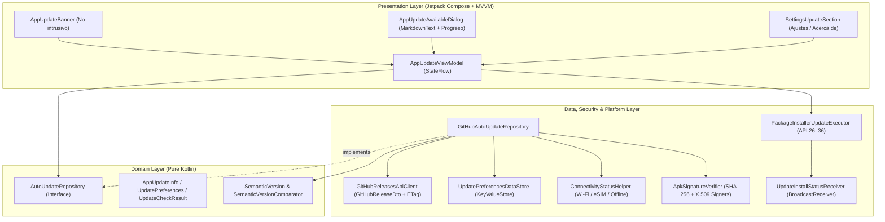
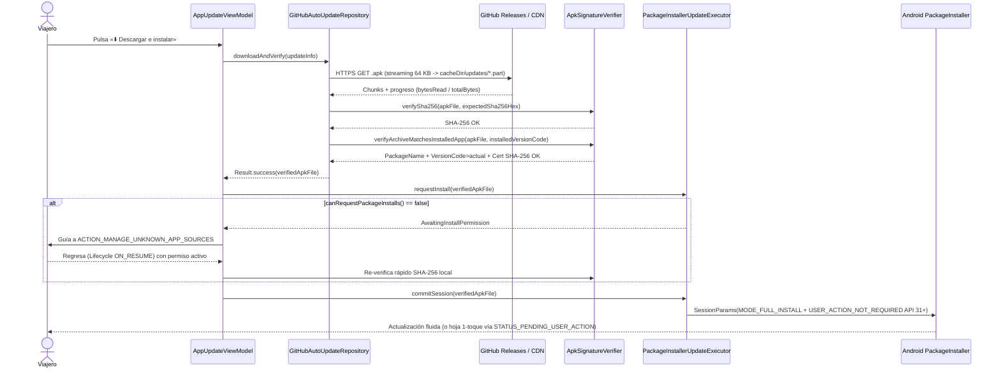

# Análisis Técnico 12: Sistema de Actualizaciones Automáticas vía GitHub Releases y Firma Criptográfica de Producción

- **ID**: `ANALYSIS-12`
- **Especificación**: [`SPEC-10 (RF-10.1 a RF-10.4)`](../specs/10-github-releases-auto-updater-spec.md)
- **Componentes Afectados**:
  - `feature.updater` (`domain`, `data`, `security`, `platform`, `ui`)
  - `core.preferences` y `core.network` (política de conectividad e integración de ajustes)
  - `feature.ai` (reutilización del motor nativo `MarkdownText` para notas del `CHANGELOG`)
  - `app/build.gradle.kts`, `keystore.example.properties`, `app/src/main/AndroidManifest.xml` y `.github/workflows/release-apk.yml`
- **Fecha**: 2026-11-07
- **Estado**: Aprobado

---

## 1. Diagnóstico del Estado Actual y Problemática Técnica

Al auditar la configuración actual del proyecto se identifican cuatro brechas técnicas que impiden actualizaciones *in-place* seguras desde **GitHub Releases**:

1. **Fallback inseguro y no determinista en `app/build.gradle.kts` (`signingConfigs.release`)**:
   - Actualmente, si no existe `keystore.properties`, el bloque `signingConfigs.create("release")` intenta usar contraseñas por defecto en texto claro (`"japantraveltools"`) o cae silenciosamente en `~/.android/debug.keystore` (`"androiddebugkey"`).
   - En runners efímeros de GitHub Actions o al compilar desde distintas estaciones de trabajo, esto genera certificados X.509 distintos en cada entrega, causando `INSTALL_FAILED_UPDATE_INCOMPATIBLE` y forzando a borrar la app y su almacenamiento privado `Context.filesDir`.
   - Tampoco se declaran explícitamente `enableV2Signing = true` ni `enableV3Signing = true`.
2. **Ausencia de permisos y receptor de sesión en `AndroidManifest.xml`**:
   - No están declarados `android.permission.REQUEST_INSTALL_PACKAGES` ni `android.permission.UPDATE_PACKAGES_WITHOUT_USER_ACTION` (API 31+, nivel de protección `normal`), ni el `BroadcastReceiver` interno requerido por `PackageInstaller.Session.commit(IntentSender)`.
3. **Inexistencia de flujo CI/CD automatizado para tags `v*`**:
   - No existe un workflow en `.github/workflows/` que ejecute la suite unitaria, decodifique secretos de firma en memoria temporal, verifique el bloque de firma v2/v3 con `apksigner` y adjunte el `.apk` firmado más su archivo `.sha256` a la GitHub Release.
4. **Cero descubrimiento OTA integrado en la app**:
   - El viajero carece de comprobación periódica respetuosa con el Modo Offline / eSIM, visor nativo Markdown de novedades y verificador criptográfico pre-instalación (hash `SHA-256` + certificado firmante).

---

## 2. Arquitectura de la Solución (Clean Architecture + MVVM / UDF)

El módulo se estructura bajo `com.laralbir.japantraveltools.feature.updater` sin introducir librerías externas pesadas, reutilizando `HttpURLConnection`, `org.json` (ya disponible en `testImplementation("org.json:json:20240303")` y Android SDK), `KeyValueStore`, `ConnectivityStatusHelper` y `MarkdownText`:



### Flujo Secuencial de Descarga, Doble Verificación e Instalación (`RF-10.4`)



---

## 3. Diseño Detallado de Componentes y Contratos Kotlin

### 3.1 Comparador SemVer 2.0.0 (`feature/updater/domain/SemanticVersionComparator.kt`)

Implementación determinista y pura en Kotlin compatible con pruebas unitarias JVM sin dependencias de Android:

```kotlin
package com.laralbir.japantraveltools.feature.updater.domain

data class SemanticVersion(
    val major: Int,
    val minor: Int,
    val patch: Int,
    val preReleaseIdentifiers: List<String> = emptyList(),
    val buildMetadata: String? = null
) : Comparable<SemanticVersion> {

    val isPreRelease: Boolean get() = preReleaseIdentifiers.isNotEmpty()

    override fun compareTo(other: SemanticVersion): Int {
        if (major != other.major) return major.compareTo(other.major)
        if (minor != other.minor) return minor.compareTo(other.minor)
        if (patch != other.patch) return patch.compareTo(other.patch)

        // SemVer 2.0.0 §11: versión estable > versión pre-release con igual MAJOR.MINOR.PATCH
        if (preReleaseIdentifiers.isEmpty() && other.preReleaseIdentifiers.isEmpty()) return 0
        if (preReleaseIdentifiers.isEmpty()) return 1
        if (other.preReleaseIdentifiers.isEmpty()) return -1

        val maxCommon = minOf(preReleaseIdentifiers.size, other.preReleaseIdentifiers.size)
        for (i in 0 until maxCommon) {
            val a = preReleaseIdentifiers[i]
            val b = other.preReleaseIdentifiers[i]
            if (a == b) continue
            val aNum = a.toLongOrNull()
            val bNum = b.toLongOrNull()
            return when {
                aNum != null && bNum != null -> aNum.compareTo(bNum)
                aNum != null -> -1 // Identificador numérico tiene menor precedencia que alfanumérico
                bNum != null -> 1
                else -> a.compareTo(b)
            }
        }
        return preReleaseIdentifiers.size.compareTo(other.preReleaseIdentifiers.size)
    }

    companion object {
        private val SEMVER_REGEX = Regex(
            """^[vV]?(0|[1-9]\d*)\.(0|[1-9]\d*)\.(0|[1-9]\d*)(?:-([0-9A-Za-z-]+(?:\.[0-9A-Za-z-]+)*))?(?:\+([0-9A-Za-z-]+(?:\.[0-9A-Za-z-]+)*))?$"""
        )

        fun parseOrNull(raw: String): SemanticVersion? {
            val match = SEMVER_REGEX.matchEntire(raw.trim()) ?: return null
            val major = match.groupValues[1].toIntOrNull() ?: return null
            val minor = match.groupValues[2].toIntOrNull() ?: return null
            val patch = match.groupValues[3].toIntOrNull() ?: return null
            val preRelease = match.groupValues[4]
                .takeIf { it.isNotEmpty() }
                ?.split('.')
                ?: emptyList()
            val build = match.groupValues[5].takeIf { it.isNotEmpty() }
            return SemanticVersion(major, minor, patch, preRelease, build)
        }
    }
}

object SemanticVersionComparator : Comparator<String> {
    override fun compare(leftVersion: String, rightVersion: String): Int {
        val left = SemanticVersion.parseOrNull(leftVersion)
        val right = SemanticVersion.parseOrNull(rightVersion)
        return when {
            left != null && right != null -> left.compareTo(right)
            left != null -> 1
            right != null -> -1
            else -> 0
        }
    }

    fun isRemoteNewer(installedVersion: String, remoteTag: String): Boolean =
        compare(remoteTag, installedVersion) > 0
}
```

---

### 3.2 DTOs de Red y Modelo de Dominio (`GitHubReleaseDto` y `AppUpdateInfo`)

- **`GitHubReleaseDto` (`feature/updater/data/GitHubReleaseDto.kt`)**:
  ```kotlin
  data class GitHubAssetDto(
      val id: Long,
      val name: String,
      val contentType: String,
      val sizeBytes: Long,
      val browserDownloadUrl: String,
      val digest: String? // Formato GitHub REST API: "sha256:<64-hex>" o null
  )

  data class GitHubReleaseDto(
      val id: Long,
      val tagName: String,
      val name: String,
      val bodyMarkdown: String,
      val draft: Boolean,
      val prerelease: Boolean,
      val publishedAtIso: String,
      val htmlUrl: String,
      val assets: List<GitHubAssetDto>
  )
  ```
  - **Regla de mapeo a `AppUpdateInfo`**:
    1. Se descartan releases con `draft == true` y, si `includePreReleases == false`, aquellas con `prerelease == true`.
    2. Se localiza el asset principal cuyo nombre termine en `.apk` (`contentType == "application/vnd.android.package-archive"` o sufijo `.apk` case-insensitive).
    3. Se extrae `expectedSha256Hex` limpiando el prefijo `"sha256:"` de `apkAsset.digest` (validando longitud de 64 caracteres hexadecimales `[0-9a-f]{64}`).
    4. Si `apkAsset.digest` fuera nulo, se localiza en `assets` el fichero homónimo `<apkName>.sha256` (o `checksums.sha256`) exponiendo `checksumAssetUrl` para descargarlo antes de validar el binario.

- **`AppUpdateInfo` (`feature/updater/domain/AppUpdateModels.kt`)**:
  ```kotlin
  data class AppUpdateInfo(
      val tagName: String,
      val cleanVersionName: String,
      val releaseTitle: String,
      val changelogMarkdown: String,
      val publishedAtIso: String,
      val apkAssetName: String,
      val apkDownloadUrl: String,
      val apkSizeBytes: Long,
      val expectedSha256Hex: String?,
      val checksumAssetUrl: String?,
      val isPreRelease: Boolean,
      val releasePageUrl: String
  )
  ```

---

### 3.3 Persistencia de Preferencias (`UpdatePreferencesDataStore`)

Construido sobre la interfaz existente `KeyValueStore` (`SharedPrefsKeyValueStore` en producción e `InMemoryKeyValueStore` en tests unitarios rápidos) exponiendo un `StateFlow<UpdatePreferences>`:

```kotlin
enum class UpdateNetworkPolicy { WIFI_ONLY, WIFI_AND_CELLULAR }

data class UpdatePreferences(
    val autoCheckEnabled: Boolean = true,
    val networkPolicy: UpdateNetworkPolicy = UpdateNetworkPolicy.WIFI_ONLY,
    val includePreReleases: Boolean = false,
    val lastUpdateCheckEpochMillis: Long = 0L,
    val dismissedVersionTag: String? = null,
    val lastEtag: String? = null,
    val cachedReleaseJson: String? = null,
    val pendingVerifiedApkPath: String? = null,
    val lastKnownInstalledVersionCode: Long = 0L
)
```

---

### 3.4 Repositorio Offline-First (`GitHubAutoUpdateRepository`)

Responsabilidades y reglas de negocio encapsuladas:
1. **Política de elegibilidad para comprobación (`shouldRunCheck`)**:
   - Si `manual == false`:
     - Requiere `prefs.autoCheckEnabled == true`.
     - Requiere `nowMillis - prefs.lastUpdateCheckEpochMillis >= 12 * 60 * 60 * 1000L` (`43_200_000L`).
     - Consulta `ConnectivityStatusHelper.inspectCurrentConnection(context, forceOfflineByApp)`:
       - Si `!snapshot.isOnline || snapshot.isRoaming` ➔ retorna `UpdateCheckOutcome.SkippedOfflineOrPolicy`.
       - Si `prefs.networkPolicy == UpdateNetworkPolicy.WIFI_ONLY && snapshot.kind != ActiveConnectionKind.WIFI` ➔ retorna `UpdateCheckOutcome.SkippedOfflineOrPolicy`.
   - Si `manual == true`:
     - Si `forceOfflineByApp` o `!snapshot.isOnline` ➔ retorna `UpdateCheckOutcome.OfflineUnavailable` de forma inmediata sin bloquear.
     - Ignora el cooldown de 12 horas y el filtro `dismissedVersionTag`.
2. **Validación de dominios permitidos (Anti-SSRF / Anti-Downgrade de protocolo)**:
   - Solo permite descargas `https://` desde hosts `api.github.com`, `github.com` y `objects.githubusercontent.com` (configurando `HttpURLConnection.instanceFollowRedirects = false` para inspeccionar manualmente la cabecera `Location` en redirecciones `302` de GitHub Releases hacia su CDN firmada, garantizando que jamás derive a `http://`).
3. **Descarga atómica con `DigestInputStream` y cancelación cooperativa**:
   - Verifica `updatesDir.usableSpace >= (updateInfo.apkSizeBytes * 22L) / 10L`.
   - Descarga en `File(context.cacheDir, "updates/jtt-${updateInfo.cleanVersionName}.apk.part")` en bloques de `64 * 1024` bytes invocando `coroutineContext.ensureActive()` en cada iteración; ante `CancellationException` o excepción de E/S, el bloque `catch` invoca `partFile.delete()` de inmediato.
   - Al concluir, compara el SHA-256 calculado con `expectedSha256Hex` (o descarga y parsea `checksumAssetUrl` si `expectedSha256Hex == null`), renombra a `.apk` e invoca `ApkSignatureVerifier`.

---

### 3.5 Doble Verificador Criptográfico (`ApkSignatureVerifier`)

Diseñado para cubrir con rigor desde `minSdk = 26` (Android 8.0) hasta `targetSdk = 36` (Android 16):

```kotlin
sealed interface ApkVerificationResult {
    data class Verified(val sha256Hex: String, val certSha256Hex: String, val archiveVersionCode: Long) : ApkVerificationResult
    data class ChecksumMismatch(val expectedHex: String?, val actualHex: String) : ApkVerificationResult
    data class InvalidArchive(val reason: String) : ApkVerificationResult
    data class PackageNameMismatch(val expectedPackage: String, val actualPackage: String) : ApkVerificationResult
    data class VersionDowngradeBlocked(val installedVersionCode: Long, val archiveVersionCode: Long) : ApkVerificationResult
    data class SignatureMismatch(val installedCertSha256: Set<String>, val archiveCertSha256: Set<String>) : ApkVerificationResult
}
```

- **Extracción de certificados X.509 compatible por nivel de API**:
  - **API 33+ (`TIRAMISU`)**: `packageManager.getPackageArchiveInfo(apkPath, PackageManager.PackageInfoFlags.of(PackageManager.GET_SIGNING_CERTIFICATES.toLong()))` y `getPackageInfo(packageName, PackageInfoFlags.of(GET_SIGNING_CERTIFICATES.toLong()))`.
  - **API 28–32 (`P`..`S_V2`)**: sobrecargas `Int` con `PackageManager.GET_SIGNING_CERTIFICATES`. Si `signingInfo.hasMultipleSigners()` es `true`, todos los `apkContentsSigners` deben coincidir; en caso contrario se evalúa `signingInfo.signingCertificateHistory` / firmante activo.
  - **API 26–27 (`O`..`O_MR1`, dado `minSdk = 26`)**: fallback seguro a `PackageManager.GET_SIGNATURES` hasheando cada `Signature.toByteArray()` con `SHA-256`.
- **Inyección para Testabilidad Unitaria (TDD)**:
  - Se abstrae la lectura del `PackageManager` detrás de `PackageSignatureInspector` (`interface PackageSignatureInspector`), permitiendo testear en JVM (`src/test`) todos los escenarios de seguridad (SHA-256 corrupto, nombre de paquete suplantado, intento de downgrade `versionCode <= actual`, certificado MITM distinto y éxito completo) sin requerir un emulador pesado.
- **Huella corta para UI de Ajustes (`formatShortFingerprint`)**:
  - Convierte el hash hexadecimal de 64 caracteres a formato legible `AB:CD:12:34:…:EF:90` para mostrarlo en la tarjeta `Acerca de / Actualizaciones`.

---

### 3.6 Ejecutor `PackageInstaller` y `UpdateInstallStatusReceiver` (`PackageInstallerUpdateExecutor`)

1. **Gestión del permiso `REQUEST_INSTALL_PACKAGES`**:
   - `canInstallPackages(): Boolean = context.packageManager.canRequestPackageInstalls()` (disponible nativamente desde API 26 = `minSdk`).
   - `createManageUnknownSourcesIntent(): Intent = Intent(Settings.ACTION_MANAGE_UNKNOWN_APP_SOURCES, Uri.parse("package:${context.packageName}"))`.
   - En `AppUpdateViewModel`, si el usuario pulsa instalar y `canInstallPackages() == false`, la UI transita a `UpdateUiState.AwaitingInstallPermission(updateInfo, apkFile)`. Un `LifecycleEventObserver` en la pantalla detecta `Lifecycle.Event.ON_RESUME`; cuando `canInstallPackages()` pasa a `true`, revalida el hash `SHA-256` del fichero en caché privada y ejecuta `installVerifiedApk(apkFile)` automáticamente.

2. **Construcción de la sesión `PackageInstaller`**:
   ```kotlin
   val packageInstaller = context.packageManager.packageInstaller
   val params = PackageInstaller.SessionParams(PackageInstaller.SessionParams.MODE_FULL_INSTALL).apply {
       setAppPackageName(context.packageName)
       setSize(apkFile.length())
       if (Build.VERSION.SDK_INT >= Build.VERSION_CODES.S) {
           setRequireUserAction(PackageInstaller.SessionParams.USER_ACTION_NOT_REQUIRED)
       }
       if (Build.VERSION.SDK_INT >= Build.VERSION_CODES.UPSIDE_DOWN_CAKE) {
           setRequestUpdateOwnership(true)
       }
   }
   val sessionId = packageInstaller.createSession(params)
   packageInstaller.openSession(sessionId).use { session ->
       apkFile.inputStream().use { input ->
           session.openWrite("jtt_update_base.apk", 0, apkFile.length()).use { output ->
               input.copyTo(output, bufferSize = 64 * 1024)
               session.fsync(output)
           }
       }
       val statusIntent = Intent(context, UpdateInstallStatusReceiver::class.java).apply {
           action = UpdateInstallStatusReceiver.ACTION_INSTALL_STATUS
           setPackage(context.packageName)
       }
       val pendingFlags = PendingIntent.FLAG_UPDATE_CURRENT or
           (if (Build.VERSION.SDK_INT >= Build.VERSION_CODES.S) PendingIntent.FLAG_MUTABLE else 0)
       val pendingIntent = PendingIntent.getBroadcast(context, sessionId, statusIntent, pendingFlags)
       session.commit(pendingIntent.intentSender)
   }
   ```
   > **Nota de Seguridad Android 14+ (`UPSIDE_DOWN_CAKE`, `targetSdk = 36`)**: Android exige que un `PendingIntent` con `FLAG_MUTABLE` utilice siempre un `Intent` **explícito** (`Intent(context, UpdateInstallStatusReceiver::class.java)` + `setPackage(context.packageName)`). Hacerlo así cumple estrictamente las restricciones de seguridad de Android 14/15/16 sin lanzar `IllegalArgumentException`.

3. **Receptor `UpdateInstallStatusReceiver`**:
   - Registrado en `AndroidManifest.xml` con `android:exported="false"`.
   - Cuando recibe `PackageInstaller.STATUS_PENDING_USER_ACTION`: extrae el `Intent` de confirmación de `Intent.EXTRA_INTENT` (usando `IntentCompat.getParcelableExtra(intent, Intent.EXTRA_INTENT, Intent::class.java)`), le añade `Intent.FLAG_ACTIVITY_NEW_TASK` y lanza el diálogo del sistema.
   - Cuando recibe `STATUS_FAILURE*`: publica el fallo tipado en `InstallResultBus` (`SharedFlow`) para que `AppUpdateViewModel` muestre la causa exacta al usuario.

---

## 4. Configuración Gradle (`signingConfigs.release`), Plantilla de Secretos y Manifiesto

### 4.1 Endurecimiento de `app/build.gradle.kts`

Se reemplaza el bloque `signingConfigs` actual eliminando contraseñas hardcodeadas y activando explícitamente los esquemas v1, v2 y v3:

```kotlin
  signingConfigs {
    create("release") {
      val keystorePropsFile = rootProject.file("keystore.properties")
      val localProps = Properties().apply {
        if (keystorePropsFile.exists()) {
          FileInputStream(keystorePropsFile).use { load(it) }
        }
      }

      val resolvedStorePath = localProps.getProperty("storeFile")
        ?: System.getenv("SIGNING_KEYSTORE_PATH")
      val resolvedStorePassword = localProps.getProperty("storePassword")
        ?: System.getenv("SIGNING_STORE_PASSWORD")
      val resolvedKeyAlias = localProps.getProperty("keyAlias")
        ?: System.getenv("SIGNING_KEY_ALIAS")
      val resolvedKeyPassword = localProps.getProperty("keyPassword")
        ?: System.getenv("SIGNING_KEY_PASSWORD")

      if (!resolvedStorePath.isNullOrBlank() &&
          !resolvedStorePassword.isNullOrBlank() &&
          !resolvedKeyAlias.isNullOrBlank() &&
          !resolvedKeyPassword.isNullOrBlank()
      ) {
        storeFile = rootProject.file(resolvedStorePath)
        storePassword = resolvedStorePassword
        keyAlias = resolvedKeyAlias
        keyPassword = resolvedKeyPassword
        enableV1Signing = true
        enableV2Signing = true
        enableV3Signing = true
      } else {
        val isReleaseTaskRequested = gradle.startParameter.taskNames.any { task ->
          task.contains("Release", ignoreCase = true)
        }
        if (System.getenv("CI") == "true" && isReleaseTaskRequested) {
          throw GradleException(
            "Missing release signing credentials in CI. Configure SIGNING_KEYSTORE_PATH, " +
              "SIGNING_STORE_PASSWORD, SIGNING_KEY_ALIAS, and SIGNING_KEY_PASSWORD."
          )
        }
      }
    }
  }
```

### 4.2 Plantilla Versionada `keystore.example.properties`

Se añade en la raíz del repositorio (mientras `keystore.properties`, `*.jks` y `*.keystore` permanecen ignorados en `.gitignore`):

```properties
# Plantilla de configuración local de firma de producción (NO commitear valores reales).
# Copia este archivo a 'keystore.properties' (ignorado por Git) y apunta a tu Keystore PKCS#12 oficial.
# Generación inicial única recomendada:
# keytool -genkeypair -v -storetype PKCS12 -keystore release-production.jks -keyalg RSA -keysize 4096 -validity 10000 -alias japan_travel_release
storeFile=release-production.jks
storePassword=CHANGE_ME_STORE_PASSWORD
keyAlias=japan_travel_release
keyPassword=CHANGE_ME_KEY_PASSWORD
```

### 4.3 Declaraciones en `app/src/main/AndroidManifest.xml`

```xml
    <uses-permission android:name="android.permission.REQUEST_INSTALL_PACKAGES" />
    <uses-permission android:name="android.permission.UPDATE_PACKAGES_WITHOUT_USER_ACTION" />
```
Y dentro de `<application ...>`:
```xml
        <receiver
            android:name=".feature.updater.platform.UpdateInstallStatusReceiver"
            android:exported="false" />
```

---

## 5. Workflow CI/CD en GitHub Actions (`.github/workflows/release-apk.yml`)

Pipeline automatizado disparado al publicar cualquier tag anotado `v*` (ej. `v1.3.1` o `v1.4.0-beta.1`):

```yaml
name: Build, Sign & Publish Release APK

on:
  push:
    tags:
      - 'v*'
  workflow_dispatch:
    inputs:
      tag_name:
        description: 'Existing Git tag to build and attach (e.g. v1.3.0)'
        required: true
        type: string

permissions:
  contents: write

jobs:
  release-signed-apk:
    name: Test, Sign Release APK (v2/v3) & Publish GitHub Release
    runs-on: ubuntu-latest
    steps:
      - name: Checkout repository
        uses: actions/checkout@v4
        with:
          fetch-depth: 0

      - name: Set up JDK 17
        uses: actions/setup-java@v4
        with:
          distribution: 'temurin'
          java-version: '17'

      - name: Setup Gradle cache
        uses: gradle/actions/setup-gradle@v4

      - name: Run JVM Unit Test Suite (Quality Gate)
        run: ./gradlew testDebugUnitTest --no-daemon

      - name: Decode Production PKCS#12 Keystore to ephemeral runner temp
        env:
          SIGNING_KEYSTORE_BASE64: ${{ secrets.SIGNING_KEYSTORE_BASE64 }}
        run: |
          if [ -z "$SIGNING_KEYSTORE_BASE64" ]; then
            echo "::error::Missing SIGNING_KEYSTORE_BASE64 repository secret."
            exit 1
          fi
          echo "$SIGNING_KEYSTORE_BASE64" | base64 --decode > "$RUNNER_TEMP/release-production.jks"
          chmod 600 "$RUNNER_TEMP/release-production.jks"

      - name: Assemble Signed Production Release APK
        env:
          CI: 'true'
          SIGNING_KEYSTORE_PATH: ${{ runner.temp }}/release-production.jks
          SIGNING_STORE_PASSWORD: ${{ secrets.SIGNING_STORE_PASSWORD }}
          SIGNING_KEY_ALIAS: ${{ secrets.SIGNING_KEY_ALIAS }}
          SIGNING_KEY_PASSWORD: ${{ secrets.SIGNING_KEY_PASSWORD }}
        run: ./gradlew assembleRelease --no-daemon

      - name: Verify APK Signature Schemes v2 & v3 and Prepare Checksum
        id: artifact
        run: |
          TAG="${{ github.event.inputs.tag_name || github.ref_name }}"
          RAW_APK="app/build/outputs/apk/release/app-release.apk"
          OUT_APK="japan-travel-tools-${TAG}.apk"
          cp "$RAW_APK" "$OUT_APK"

          APKSIGNER=$(find "$ANDROID_HOME/build-tools" -name apksigner | sort -V | tail -n 1)
          VERIFY_OUT=$("$APKSIGNER" verify --verbose --print-certs "$OUT_APK")
          echo "$VERIFY_OUT"
          echo "$VERIFY_OUT" | grep -q "Verified using v2 scheme (APK Signature Scheme v2): true"
          echo "$VERIFY_OUT" | grep -q "Verified using v3 scheme (APK Signature Scheme v3): true"

          sha256sum "$OUT_APK" > "${OUT_APK}.sha256"
          IS_PRERELEASE="false"
          if [[ "$TAG" == *"-beta"* || "$TAG" == *"-alpha"* || "$TAG" == *"-rc"* ]]; then
            IS_PRERELEASE="true"
          fi
          echo "apk_file=${OUT_APK}" >> "$GITHUB_OUTPUT"
          echo "sha_file=${OUT_APK}.sha256" >> "$GITHUB_OUTPUT"
          echo "tag=${TAG}" >> "$GITHUB_OUTPUT"
          echo "is_prerelease=${IS_PRERELEASE}" >> "$GITHUB_OUTPUT"

      - name: Extract Release Notes from CHANGELOG.md
        run: |
          TAG="${{ steps.artifact.outputs.tag }}"
          VERSION_NO_V="${TAG#v}"
          awk -v ver="$VERSION_NO_V" '
            $0 ~ "^## \\[" ver "\\]" { found=1; next }
            found && /^## \[/ { exit }
            found { print }
          ' CHANGELOG.md > release_notes.md
          if [ ! -s release_notes.md ]; then
            echo "Release ${TAG} of Japan Travel Tools." > release_notes.md
          fi

      - name: Publish GitHub Release with Signed APK & SHA-256
        uses: softprops/action-gh-release@v2
        with:
          tag_name: ${{ steps.artifact.outputs.tag }}
          name: Japan Travel Tools ${{ steps.artifact.outputs.tag }}
          body_path: release_notes.md
          prerelease: ${{ steps.artifact.outputs.is_prerelease == 'true' }}
          draft: false
          files: |
            ${{ steps.artifact.outputs.apk_file }}
            ${{ steps.artifact.outputs.sha_file }}

      - name: Scrub Ephemeral Keystore
        if: always()
        run: rm -f "$RUNNER_TEMP/release-production.jks"
```

---

## 6. Estrategia de Testing (TDD Estricto: Red ➔ Green ➔ Refactor)

Toda la lógica crítica de versiones, parsing de red, políticas offline/Wi-Fi, verificación criptográfica y máquina de estados se valida mediante pruebas unitarias rápidas en `app/src/test/kotlin/com/laralbir/japantraveltools/feature/updater/`:

1. **`SemanticVersionComparatorTest.kt`**:
   - Comparación `MAJOR`, `MINOR` y `PATCH` con varios dígitos (`1.10.0 > 1.2.9`).
   - Precedencia estricta SemVer 2.0.0: `0.0.1-beta.1 < 0.0.1-beta.2 < 0.0.1-beta.10 < 0.0.1` y `1.3.0 < 1.4.0-beta.1 < 1.4.0`.
   - Normalización de prefijo `v`/`V`, ignorado de `+build` y resiliencia frente a cadenas inválidas.
2. **`GitHubReleaseDtoParserTest.kt`**:
   - Parseo de respuesta de `/releases/latest` extrayendo `tag_name`, `body`, asset `.apk`, `size` y `digest` (`"sha256:<64-hex>"` -> `<64-hex>`).
   - Fallback al asset `.sha256` cuando `digest` es `null` y parseo de formato estándar GNU coreutils (`<64-hex>  japan-travel-tools-v1.4.0.apk`).
   - Selección correcta en `/releases` ignorando `draft == true` y filtrando `prerelease == true` cuando `includePreReleases == false`.
3. **`ApkSignatureVerifierTest.kt`**:
   - Cálculo real de `SHA-256` sobre ficheros temporales y detección inmediata de alteración de 1 solo bit (`ChecksumMismatch`).
   - Rechazo cuando `packageName != "com.laralbir.japantraveltools"` (`PackageNameMismatch`).
   - Rechazo ante `archiveVersionCode <= installedVersionCode` (`VersionDowngradeBlocked`).
   - Rechazo ante certificado X.509 distinto al instalado (`SignatureMismatch` — simulación de ataque MITM o cruce `debug` vs `release`).
   - Éxito (`Verified`) únicamente cuando SHA-256, `packageName`, `versionCode` creciente y certificado coinciden, más formato de huella corta `AB:CD:...:EF`.
4. **`GitHubAutoUpdateRepositoryTest.kt`**:
   - Bloqueo total de llamadas HTTP cuando `forceOfflineMode == true`, sin red, en Roaming (`isRoaming == true`) o con red móvil bajo política `WIFI_ONLY`.
   - Cumplimiento del cooldown de 12 horas en modo automático y bypass del cooldown en comprobación manual (`manual = true`).
   - Persistencia y respeto de `dismissedVersionTag` en modo automático, reactivación ante versión superior (`v1.4.1 > v1.4.0`) y visibilidad al forzar búsqueda manual.
   - Borrado inmediato del fichero `.apk` / `.part` en `cacheDir/updates/` ante cancelación de corrutina o fallo de verificación criptográfica, y autolimpieza al detectar `currentVersionCode > lastKnownInstalledVersionCode`.
5. **`AppUpdateViewModelTest.kt`**:
   - Transiciones deterministas de `UpdateUiState`: `Idle -> Checking -> UpdateAvailable -> Downloading -> Verifying -> AwaitingInstallPermission -> (ON_RESUME con permiso concedido) -> Installing`, así como acciones *"Recordar más tarde"* y *"Omitir esta versión"*.
