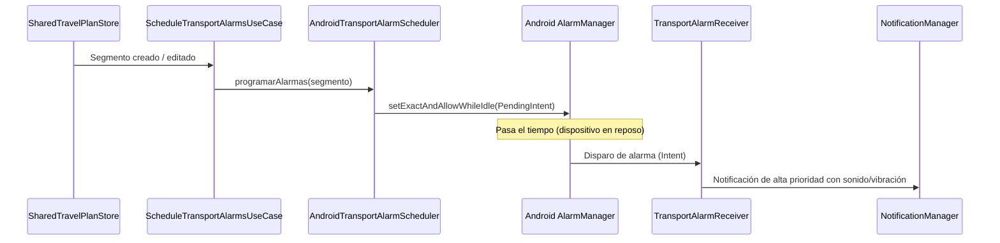

# ANALYSIS-14: Diseño Técnico del Motor de Alarmas y Notificaciones de Transporte Offline

- **ID**: `ANALYSIS-14`
- **Especificación**: [`SPEC-12`](../specs/12-transport-alarms-spec.md)
- **Capa**: Platform, Data & Domain (`AlarmManager`, `BroadcastReceiver`, `NotificationCompat`)
- **Paquete Kotlin**: `com.laralbir.japantraveltools.feature.transport.alarm`

---

## 1. Arquitectura de Alarmas Offline

El subsistema de alarmas se apoya en los componentes nativos del sistema Android para garantizar activación exacta sin requerir procesos en segundo plano consumidores de batería:

```
feature.transport.alarm/
├── domain/
│   ├── model/
│   │   ├── TransportAlarmSchedule.kt      # Entidad de alarma programada
│   │   └── TransportAlarmType.kt          # CHECK_IN, DEPARTURE_60M, DEPARTURE_15M, ARRIVAL_5M
│   ├── usecase/
│   │   ├── CalculateTransportAlarmsUseCase.kt # Cálculo de instantes UTC de disparo
│   │   └── ScheduleTransportAlarmsUseCase.kt  # Orquestador con AlarmManager
│   └── repository/
│       └── TransportAlarmScheduler.kt     # Contrato de programación y cancelación
├── data/
│   └── AndroidTransportAlarmScheduler.kt  # Implementación nativa con AlarmManager
└── platform/
    ├── TransportAlarmReceiver.kt          # BroadcastReceiver que recibe el disparo de la alarma
    ├── TransportBootReceiver.kt           # BroadcastReceiver para ACTION_BOOT_COMPLETED
    └── TransportNotificationDispatcher.kt # Construye y muestra NotificationCompat
```

---

## 2. Flujo de Programación y Despacho



---

## 3. Identificadores Únicos y PendingIntents

Para evitar colisiones entre las múltiples alarmas de un mismo viaje:
- El código de solicitud (`requestCode`) de cada `PendingIntent` se genera a partir de la combinación determinista:
  ```kotlin
  val requestCode = (segmentId.hashCode() xor alarmType.ordinal) and 0x7FFFFFFF
  ```
- Al cancelar un tramo, se recrean los `PendingIntent` con la bandera `PendingIntent.FLAG_NO_CREATE` o idéntico intent explícito y se invoca `alarmManager.cancel(pendingIntent)`.

---

## 4. Estrategia de Testing (TDD)

1. **`CalculateTransportAlarmsUseCaseTest`**:
   - Validar que un vuelo con salida `2026-10-15T10:00:00Z` genera exactamente:
     - Check-in 24h: `2026-10-14T10:00:00Z`.
     - Check-in 2h: `2026-10-15T08:00:00Z`.
     - Salida 60m: `2026-10-15T09:00:00Z`.
     - Salida 15m: `2026-10-15T09:45:00Z`.
   - Validar que instantes en el pasado relativo no se devuelven en la lista de alarmas a programar.
   - Validar que un Shinkansen genera alarma de salida 60m, 15m y alarma de llegada 5m antes de `arrivalTimeIso`.
2. **`AndroidTransportAlarmSchedulerTest`**:
   - Mockear `AlarmManager` y verificar llamadas a `setExactAndAllowWhileIdle` o `setAlarmClock` con flags correctas (`FLAG_IMMUTABLE` / `FLAG_UPDATE_CURRENT`).
   - Verificar llamadas a `cancel` al eliminar tramos.
