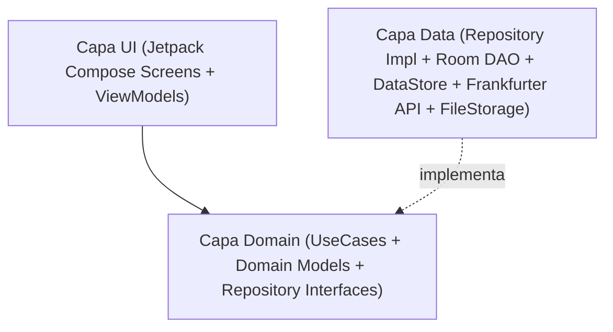

# Análisis Técnico: Arquitectura Android, Stack Tecnológico y Estrategia TDD

Este documento recoge la fase de **Análisis** del flujo SDD para traducir las especificaciones [`SPEC-00`](../specs/00-core-configuration-spec.md), [`SPEC-01`](../specs/01-world-clock-spec.md), [`SPEC-02`](../specs/02-currency-converter-spec.md), [`SPEC-03`](../specs/03-documents-and-id-vault-spec.md), [`SPEC-04`](../specs/04-trip-planner-spec.md) y [`SPEC-05`](../specs/05-flight-planner-spec.md) en una arquitectura sólida, desacoplada y 100% verificable mediante TDD.

---

## 1. Stack Tecnológico

- **Lenguaje**: Kotlin 2.x (Coroutines + Flow + Kotlin Serialization).
- **SDK de Android**:
  - `minSdk`: 26 (Android 8.0, soporte nativo completo de `java.time` y `PdfRenderer`).
  - `targetSdk` / `compileSdk`: 35 (Android 15).
- **UI, Sistema de Diseño (`KotlinConf` Blueprint + Colores de Japón) y Diseño Adaptativo**:
  - **Jetpack Compose + Material Design 3 + Navigation Compose (Type-Safe Navigation)**.
  - **Template Visual basado en [`JetBrains/kotlinconf-app`](https://jetbrains.github.io/kotlinconf-app/)**:
    - Arquitectura de Design System modular (`JapanTravelTheme`) inspirada en los componentes de KotlinConf App: tarjetas con bordes definidos (`1.dp`), chips de filtrado estilo agenda de conferencia (ideales para el Planificador de Viaje por días/horarios y filtro de Guías por ciudad), cabeceras colapsables limpias y tipografía con dígitos tabulares (`fontFeatureSettings = "tnum"`) para relojes y divisas.
    - **Paleta de Colores de Japón (`Nippon Dentōshoku`)**:
      - *Primary*: `Akabeni / Torii Red` (`#C9171E` Light / `#FF5A5F` Dark).
      - *Secondary*: `Ai-iro Japanese Indigo` (`#165E83` Light / `#64B5F6` Dark).
      - *Tertiary*: `Matcha Green` (`#5B8930` Light / `#81C784` Dark) & `Sakura Pink` (`#F4A7B9`).
      - *Surfaces*: Papel cálido `Washi` (`#FAF7F2` / `#FFFFFF`) en modo Claro y tinta `Sumi` (`#0F1115` / `#181B22`) en modo Oscuro.
  - **Material 3 Adaptive (`androidx.compose.material3.adaptive:adaptive`, `adaptive-layout`, `adaptive-navigation`, `material3-adaptive-navigation-suite`)** + **`WindowSizeClass`**:
    - Optimización específica para **Google Pixel 10 Pro XL / Pixel 9 Pro XL** (`Compact` width, pantallas altas 20:9 de 6.8" 1344x2992 a 120Hz, `enableEdgeToEdge()`, controles en zona inferior del pulgar).
    - Optimización específica para **Tablet TCL NXTPAPER 11 Plus** (`Medium` / `Expanded` width, 11.5" 2200x1440 ratio 3:2 a 120Hz): uso de `NavigationSuiteScaffold` (`NavigationRail`), `SupportingPaneScaffold` en el Planificador (Horario + Mapa Google Maps simultáneos) y `ListDetailPaneScaffold` en Documentos y Guías de Viaje, donde el estilo de bordes definidos `1.dp` de `kotlinconf-app` y el fondo *Washi* encajan de forma nativa con la pantalla mate estilo papel de NXTPAPER.
- **Mapas y Ubicación**:
  - **Google Maps SDK for Android + Maps Compose (`com.google.maps.android:maps-compose`)** para el mapa interactivo embebido en el planificador con marcadores numerados y polilíneas de ruta diaria.
  - **Google Maps Intents / Geo URIs** para lanzar navegación paso a paso y abrir fichas en la app nativa de Google Maps (compatible con mapas offline descargados en Google Maps).
  - **LocationManager / FusedLocationProvider** + resolutor offline de huso horario por coordenadas.
- **Calendario y Notificaciones**:
  - Calendario y línea temporal nativos en Compose + integración opcional con **`Android CalendarContract`** / Intents con zona horaria forzada a `Asia/Tokyo` y recordatorios vía `WorkManager` / `AlarmManager`.
- **Inyección de Dependencias**: Hilt (Dagger) o Koin / Manual DI modular (fácilmente reemplazable en tests unitarios con Fakes).
- **Persistencia Local (Offline-First)**:
  - **Jetpack DataStore (Preferences)**: Idioma, tema visual, configuración de reloj de origen, divisas por defecto, flag de bloqueo biométrico.
  - **Jetpack Room (SQLite)**:
    - Caché persistente de tipos de cambio de divisas (`CurrencyRateEntity`).
    - Metadatos del repositorio de documentos e identificación (`TravelDocumentEntity`).
    - Guías de viaje importadas y creadas en la app (`TravelGuideEntity`, `GuidePhotoEntity`).
    - Planificador de viaje, días, horarios/paradas, ubicaciones y galería de fotos por parada (`TripEntity`, `TripDayEntity`, `ItineraryItemEntity`, `ItineraryPhotoEntity`).
  - **Almacenamiento Interno (`Context.filesDir`)**: Archivos físicos `.jpg`, `.png`, `.pdf`, `.md` del pasaporte, DNI, reservas, guías y fotos del planificador.
- **Red (Con Caché Offline)**:
  - **Ktor Client** o **Retrofit + OkHttp + Kotlinx Serialization** contra `https://api.frankfurter.dev/v1/`.
- **Seguridad, Licencias Open Source e Internacionalización**:
  - **AndroidX Biometric (`BiometricPrompt`)** para protección de Pasaporte/DNI.
  - **AndroidX AppCompat (`AppCompatDelegate.setApplicationLocales`)** para soporte nativo multiidioma por aplicación (`es`, `en`).
  - **AboutLibraries (`com.mikepenz:aboutlibraries-compose-m3`)**: Plugin de Gradle que inspecciona automáticamente el árbol de dependencias en tiempo de compilación y empaqueta un JSON local en el APK con todas las librerías open source de terceros, autores, versiones y textos de licencia para mostrarlos 100% offline en Material Design 3.

---

## 2. Arquitectura (Clean Architecture + MVVM / UDF)

El código se estructura en tres capas claramente separadas con flujo de datos unidireccional (UDF):



### Estructura de Paquetes (`com.laralbir.japantraveltools`)
- `core/`
  - `designsystem/`: Tema Material 3 (Claro/Oscuro/Sistema), tipografía, componentes reutilizables, badge `BETA`.
  - `i18n/`: Gestión de idioma (Sistema -> `es`/`en` con fallback a `en`).
  - `database/`: Configuración de `RoomDatabase`.
  - `datastore/`: `UserPreferencesRepository` (DataStore).
  - `network/`: Cliente HTTP para Frankfurter API.
- `feature/settings/`: Pantalla y ViewModel de ajustes globales (idioma, tema, biometría) + pantallas `AboutScreen` (versión de la app `BuildConfig.VERSION_NAME` / `VERSION_CODE`) y `OpenSourceLicensesScreen` (listado completo de librerías de terceros).
- `feature/clock/`:
  - `domain/`: `GetWorldClocksUseCase`, `ResolveTimeZoneFromLocationUseCase`, modelo `ClockComparison`.
  - `data/`: `LocationProvider`, `OfflineTimeZoneResolver`.
  - `ui/`: `WorldClockScreen`, `WorldClockViewModel`.
- `feature/currency/`:
  - `domain/`: `ConvertCurrencyUseCase`, `SyncExchangeRatesUseCase`, `CurrencyRepository`.
  - `data/`: `FrankfurterApiService`, `CurrencyRateDao`, `SeedExchangeRates`.
  - `ui/`: `CurrencyConverterScreen`, `CurrencyConverterViewModel`.
- `feature/documents/`:
  - `domain/`: `SaveIdentityImageUseCase`, `ImportTravelDocumentUseCase`, `GetTravelDocumentsUseCase`, `ManageTravelGuidesUseCase`, `DocumentRepository`, `TravelGuideRepository`.
  - `data/`: `TravelDocumentDao`, `TravelGuideDao`, `InternalFileStorageManager`, `BiometricAuthManager`.
  - `ui/`: `DocumentsVaultScreen`, `PassportDniViewerScreen`, `PdfViewerScreen`, `TravelGuidesScreen`, `GuideEditorScreen`, `DocumentsViewModel`.
- `feature/planner/`:
  - `domain/`: `CreateTripUseCase`, `ScheduleItineraryItemUseCase`, `DetectScheduleConflictsUseCase`, `ParseGoogleMapsUrlUseCase`, `ExportToSystemCalendarUseCase`, `TripPlannerRepository`.
  - `data/`: `TripPlannerDao`, `SystemCalendarExporter`, `GoogleMapsIntentLauncher`.
  - `ui/`: `TripPlannerScreen`, `DayTimelineView`, `DayEmbeddedMapView`, `ItineraryItemEditorSheet`, `TripPlannerViewModel`.
- `feature/flights/`:
  - `domain/`: `CalculateFlightTimelineUseCase`, `CalculateLayoverInfoUseCase`, `FlightPlannerRepository`, modelos `FlightJourney`, `FlightSegment`, `LayoverDetails`.
  - `data/`: `FlightPlannerDao`, `AirportTimeZoneCatalog` (catálogo offline de aeropuertos principales como `MAD`, `BCN`, `DOH`, `DXB`, `IST`, `FRA`, `CDG`, `HND`, `NRT`, `KIX`, `FUK`, `CTS` con sus `ZoneId` y coordenadas).
  - `ui/`: `FlightPlannerScreen`, `FlightSegmentTimelineCard`, `LayoverConnectorCard`, `FlightEditorSheet`, `FlightPlannerViewModel`.

---

## 3. Diseño de Datos y Contratos Principales

### 3.1. Preferencias de Usuario (`UserPreferences`)
```kotlin
enum class AppThemeMode { SYSTEM, LIGHT, DARK }
enum class AppLanguage { SYSTEM, ENGLISH, SPANISH }

data class UserPreferences(
    val themeMode: AppThemeMode = AppThemeMode.SYSTEM,
    val language: AppLanguage = AppLanguage.SYSTEM,
    val originZoneId: String = "Europe/Madrid",
    val use24HourFormat: Boolean = true,
    val baseCurrency: String = "EUR",
    val targetCurrency: String = "JPY",
    val customExchangeRate: Double? = null,
    val biometricLockEnabled: Boolean = false
)
```

### 3.2. Caché de Divisas (`CurrencyRateEntity` & `ExchangeRateSnapshot`)
- **Tabla Room `exchange_rates`**:
  - `baseCurrency: String` (ej. `"EUR"`)
  - `targetCurrency: String` (ej. `"JPY"`)
  - `rate: Double` (ej. `163.45`)
  - `rateDate: String` (fecha oficial BCE, ej. `"2026-10-25"`)
  - `lastSyncedEpochMillis: Long`
  - `isSeedData: Boolean` (indica si es la tasa semilla preinstalada o ya actualizada de red)

### 3.3. Documentos, Identificación y Guías de Viaje (`TravelDocumentEntity` & `TravelGuideEntity`)
- **Tabla Room `travel_documents`**:
  - `id: String` (UUID)
  - `title: String`
  - `category: DocumentCategory` (`PASSPORT`, `NATIONAL_ID_FRONT`, `NATIONAL_ID_BACK`, `FLIGHT`, `HOTEL`, `TRANSPORT`, `INSURANCE`, `TICKET`, `GUIDE`, `OTHER`)
  - `internalFilePath: String` (ruta relativa dentro de `filesDir`)
  - `mimeType: String` (`image/jpeg`, `application/pdf`, `text/markdown`, etc.)
  - `documentNumberOrNotes: String?`
  - `lastReadPage: Int` (para recordar la página en guías PDF)
  - `eventDateMillis: Long?`
  - `isPinned: Boolean`
  - `createdAtMillis: Long`
- **Tabla Room `travel_guides` (Guías nativas e importadas)**:
  - `id: String` (UUID)
  - `title: String`
  - `regionCity: String` (ej. `"Tokyo"`, `"Kyoto"`, `"Osaka"`, `"General"`)
  - `tagsCsv: String` (ej. `"Ramen,Shinjuku,Compras"`)
  - `markdownContent: String` (contenido enriquecido editable offline)
  - `attachedDocumentId: String?` (FK opcional a `travel_documents` si es un PDF/mapa importado)
  - `photoPathsJson: String` (lista de rutas internas en `filesDir/guides/`)
  - `isPinned: Boolean`
  - `updatedAtMillis: Long`

### 3.4. Planificador de Viaje, Horarios, Fotos y Ubicación (`TripEntity` & `ItineraryItemEntity`)
- **Tabla Room `trips`**:
  - `id: String` (UUID)
  - `name: String` (ej. `"Japón Otoño 2026"`)
  - `startDateIso: String` (`"2026-11-10"`)
  - `endDateIso: String` (`"2026-11-24"`)
- **Tabla Room `itinerary_items` (Actividades / Paradas por Día y Horario)**:
  - `id: String` (UUID)
  - `tripId: String` (FK a `trips`)
  - `dateIso: String` (`"2026-11-10"`)
  - `startTimeIso: String` (`"09:00"`, interpretado siempre en `Asia/Tokyo`)
  - `endTimeIso: String?` (`"11:00"`)
  - `title: String` (ej. `"Visitar Templo Senso-ji"`)
  - `category: StopCategory` (`SIGHTSEEING`, `FOOD`, `TRANSPORT`, `HOTEL`, `SHOPPING`, `ACTIVITY`)
  - `notes: String?`
  - `placeNameJapanese: String?` (ej. `"浅草寺"` para mostrar offline o buscar)
  - `address: String?`
  - `latitude: Double?`
  - `longitude: Double?`
  - `googleMapsUrl: String?`
  - `photoPathsJson: String` (lista de fotos en `filesDir/planner_photos/`)
  - `linkedDocumentId: String?` (FK opcional a reserva/entrada en `travel_documents`)
  - `linkedGuideId: String?` (FK opcional a guía en `travel_guides`)
  - `syncedCalendarEventId: Long?` (ID en `CalendarContract` si fue exportado)

### 3.5. Planificador de Vuelos y Escalas (`FlightJourneyEntity` & `FlightSegmentEntity`)
- **Tabla Room `flight_journeys`** (Agrupador de trayecto, ej. *Ida a Japón* / *Vuelta a Casa* / *Vuelo doméstico*):
  - `id: String` (UUID)
  - `tripId: String?` (FK opcional a `trips`)
  - `title: String` (ej. `"Vuelo de Ida: Madrid ➔ Tokio Haneda"`)
  - `bookingReferencePnr: String?`
- **Tabla Room `flight_segments`** (Cada vuelo individual dentro del trayecto):
  - `id: String` (UUID)
  - `journeyId: String` (FK a `flight_journeys`)
  - `segmentOrder: Int` (`0`, `1`, `2`...)
  - `airline: String`
  - `flightNumber: String` (ej. `"QR806"`)
  - `departureAirportIata: String` (ej. `"MAD"`, `"DOH"`)
  - `departureCity: String`
  - `departureZoneId: String` (ej. `"Europe/Madrid"`, `"Asia/Qatar"`)
  - `departureTerminal: String?`
  - `checkInCounter: String?`
  - `boardingGate: String?`
  - `seatNumber: String?`
  - `onlineCheckInOpensIso: String?`
  - `counterCheckInTimeIso: String?` (Hora de facturación en aeropuerto)
  - `bagDropDeadlineIso: String?` (Cierre de facturación de maletas)
  - `boardingTimeIso: String?` (Hora de embarque)
  - `departureTimeIso: String` (Hora de salida local en `departureZoneId`)
  - `arrivalAirportIata: String` (ej. `"DOH"`, `"HND"`, `"NRT"`, `"KIX"`)
  - `arrivalCity: String`
  - `arrivalZoneId: String` (ej. `"Asia/Tokyo"`)
  - `arrivalTerminal: String?`
  - `baggageClaimBelt: String?`
  - `arrivalTimeIso: String` (Hora de llegada local en `arrivalZoneId`)
  - `boardingPassDocumentId: String?` (FK opcional a la tarjeta de embarque en `travel_documents`)
  - `notes: String?`

---

## 4. Estrategia de Testing (TDD)

Cada funcionalidad sigue el ciclo **Red -> Green -> Refactor**:

1. **Tests Unitarios de Dominio y Datos (`src/test/java`)**:
   - **JUnit 5 / JUnit 4 + Kotlin Coroutines Test (`runTest`) + Turbine (para Flows)**.
   - Verificación sin emulador de:
     - Resolución de idioma con fallback a `ENGLISH` cuando el locale del sistema no es `es` ni `en`.
     - Cálculo de diferencia horaria entre `Asia/Tokyo`, ubicación GPS simulada y `Europe/Madrid` (incluyendo cambios de horario de verano/invierno DST).
     - Conversión bidireccional `EUR <-> JPY`, aplicación de tasas semilla cuando no hay red, actualización de caché con Frankfurter API simulada (`MockEngine` / Fake API) y supervivencia de datos en modo offline.
     - Filtrado, categorización, alta y borrado de documentos de viaje, guías personalizadas/importadas y fotos de Pasaporte/DNI usando un `FakeFileStorageManager`.
     - Lógica del **Planificador de Viaje**: generación de días entre fechas, ordenación cronológica de horarios, detección de solapamientos (`DetectScheduleConflictsUseCase`), extracción de coordenadas desde enlaces de Google Maps (`ParseGoogleMapsUrlUseCase`) y conversión de horarios a `Asia/Tokyo` para exportación a calendario.
     - Lógica del **Planificador de Vuelos (`SPEC-05`)**: cálculo exacto de duración real de cada tramo aéreo entre distintas zonas horarias (`CalculateFlightTimelineUseCase`), cálculo de tiempo total y tiempo útil de escala hasta el siguiente embarque (`CalculateLayoverInfoUseCase`), detección de alertas de escala corta (`< 60/90 min`) y cálculo de diferencia de días (`+1 día` / `+2 días`).
2. **Tests de UI / Instrumentados (`src/androidTest/java`)**:
   - **Compose UI Test (`createComposeRule`) + Room In-Memory Database**.
   - Verificación de navegación, cambio de tema Claro/Oscuro, interacción con el conversor, selector de zona horaria de origen, creación/lectura de guías de viaje y línea temporal/mapa del planificador.
