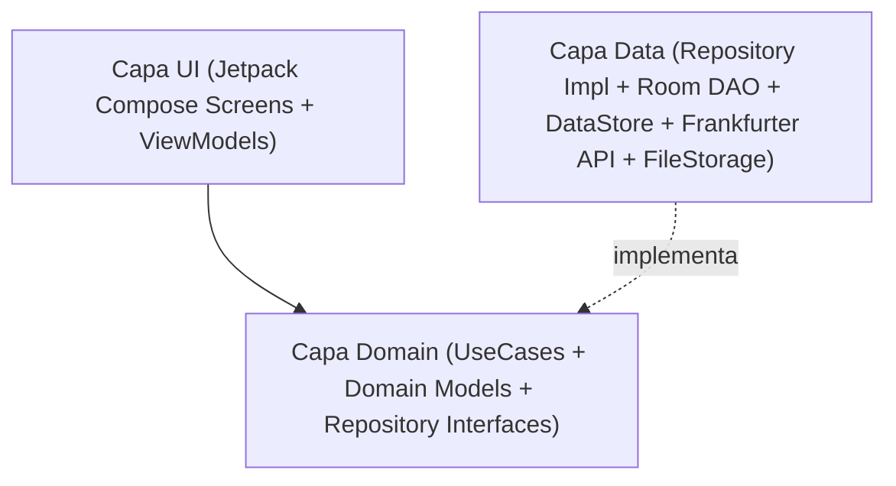

# Análisis Técnico: Arquitectura Android, Stack Tecnológico y Estrategia TDD

Este documento recoge la fase de **Análisis** del flujo SDD para traducir las especificaciones [`SPEC-00`](../specs/00-core-configuration-spec.md), [`SPEC-01`](../specs/01-world-clock-spec.md), [`SPEC-02`](../specs/02-currency-converter-spec.md) y [`SPEC-03`](../specs/03-documents-and-id-vault-spec.md) en una arquitectura sólida, desacoplada y 100% verificable mediante TDD.

---

## 1. Stack Tecnológico

- **Lenguaje**: Kotlin 2.x (Coroutines + Flow + Kotlin Serialization).
- **SDK de Android**:
  - `minSdk`: 26 (Android 8.0, soporte nativo completo de `java.time` y `PdfRenderer`).
  - `targetSdk` / `compileSdk`: 35 (Android 15).
- **UI**: Jetpack Compose + Material Design 3 + Navigation Compose (Type-Safe Navigation).
- **Inyección de Dependencias**: Hilt (Dagger) o Koin / Manual DI modular (fácilmente reemplazable en tests unitarios con Fakes).
- **Persistencia Local (Offline-First)**:
  - **Jetpack DataStore (Preferences)**: Idioma, tema visual, configuración de reloj de origen, divisas por defecto, flag de bloqueo biométrico.
  - **Jetpack Room (SQLite)**: Caché persistente de tipos de cambio de divisas (`CurrencyRateEntity`) y metadatos del repositorio de documentos e identificación (`TravelDocumentEntity`, `IdentityCardEntity`).
  - **Almacenamiento Interno (`Context.filesDir`)**: Archivos físicos `.jpg`, `.png`, `.pdf` del pasaporte, DNI y reservas de viaje.
- **Red (Con Caché Offline)**:
  - **Ktor Client** o **Retrofit + OkHttp + Kotlinx Serialization** contra `https://api.frankfurter.dev/v1/`.
- **Ubicación y Seguridad**:
  - **LocationManager / FusedLocationProvider** + resolutor offline de huso horario por coordenadas.
  - **AndroidX Biometric (`BiometricPrompt`)** para protección de Pasaporte/DNI.
  - **AndroidX AppCompat (`AppCompatDelegate.setApplicationLocales`)** para soporte nativo multiidioma por aplicación (`es`, `en`).

---

## 2. Arquitectura (Clean Architecture + MVVM / UDF)

El código se estructura en tres capas claramente separadas con flujo de datos unidireccional (UDF):



### Estructura de Paquetes (`com.laralbir.japantraveltools`)
- `core/`
  - `designsystem/`: Tema Material 3 (Claro/Oscuro/Sistema), tipografía, componentes reutilizables, badge `BETA`.
  - `i18n/`: Gestión de idioma (Sistema -> `es`/`en` con fallback a `en`).
  - `database/`: Configuración de `RoomDatabase`.
  - `datastore/`: `UserPreferencesRepository` (DataStore).
  - `network/`: Cliente HTTP para Frankfurter API.
- `feature/settings/`: Pantalla y ViewModel de ajustes globales (idioma, tema, biometría).
- `feature/clock/`:
  - `domain/`: `GetWorldClocksUseCase`, `ResolveTimeZoneFromLocationUseCase`, modelo `ClockComparison`.
  - `data/`: `LocationProvider`, `OfflineTimeZoneResolver`.
  - `ui/`: `WorldClockScreen`, `WorldClockViewModel`.
- `feature/currency/`:
  - `domain/`: `ConvertCurrencyUseCase`, `SyncExchangeRatesUseCase`, `CurrencyRepository`.
  - `data/`: `FrankfurterApiService`, `CurrencyRateDao`, `SeedExchangeRates`.
  - `ui/`: `CurrencyConverterScreen`, `CurrencyConverterViewModel`.
- `feature/documents/`:
  - `domain/`: `SaveIdentityImageUseCase`, `ImportTravelDocumentUseCase`, `GetTravelDocumentsUseCase`, `DocumentRepository`.
  - `data/`: `TravelDocumentDao`, `InternalFileStorageManager`, `BiometricAuthManager`.
  - `ui/`: `DocumentsVaultScreen`, `PassportDniViewerScreen`, `PdfViewerScreen`, `DocumentsViewModel`.

---

## 3. Diseño de Datos y Contratos Principales

### 3.1. Preferencias de Usuario (`UserPreferences`)
```kotlin
enum class AppThemeMode { SYSTEM, LIGHT, DARK }
enum class AppLanguage { SYSTEM, ENGLISH, SPANISH }

data class UserPreferences(
    val themeMode: AppThemeMode = AppThemeMode.SYSTEM,
    val language: AppLanguage = AppLanguage.SYSTEM,
    val originZoneId: String = "Europe/Madrid",
    val use24HourFormat: Boolean = true,
    val baseCurrency: String = "EUR",
    val targetCurrency: String = "JPY",
    val customExchangeRate: Double? = null,
    val biometricLockEnabled: Boolean = false
)
```

### 3.2. Caché de Divisas (`CurrencyRateEntity` & `ExchangeRateSnapshot`)
- **Tabla Room `exchange_rates`**:
  - `baseCurrency: String` (ej. `"EUR"`)
  - `targetCurrency: String` (ej. `"JPY"`)
  - `rate: Double` (ej. `163.45`)
  - `rateDate: String` (fecha oficial BCE, ej. `"2026-10-25"`)
  - `lastSyncedEpochMillis: Long`
  - `isSeedData: Boolean` (indica si es la tasa semilla preinstalada o ya actualizada de red)

### 3.3. Documentos e Identificación (`TravelDocumentEntity`)
- **Tabla Room `travel_documents`**:
  - `id: String` (UUID)
  - `title: String`
  - `category: DocumentCategory` (`PASSPORT`, `NATIONAL_ID_FRONT`, `NATIONAL_ID_BACK`, `FLIGHT`, `HOTEL`, `TRANSPORT`, `INSURANCE`, `TICKET`, `OTHER`)
  - `internalFilePath: String` (ruta relativa dentro de `filesDir`)
  - `mimeType: String` (`image/jpeg`, `application/pdf`, etc.)
  - `documentNumberOrNotes: String?`
  - `eventDateMillis: Long?`
  - `isPinned: Boolean`
  - `createdAtMillis: Long`

---

## 4. Estrategia de Testing (TDD)

Cada funcionalidad sigue el ciclo **Red -> Green -> Refactor**:

1. **Tests Unitarios de Dominio y Datos (`src/test/java`)**:
   - **JUnit 5 / JUnit 4 + Kotlin Coroutines Test (`runTest`) + Turbine (para Flows)**.
   - Verificación sin emulador de:
     - Resolución de idioma con fallback a `ENGLISH` cuando el locale del sistema no es `es` ni `en`.
     - Cálculo de diferencia horaria entre `Asia/Tokyo`, ubicación GPS simulada y `Europe/Madrid` (incluyendo cambios de horario de verano/invierno DST).
     - Conversión bidireccional `EUR <-> JPY`, aplicación de tasas semilla cuando no hay red, actualización de caché con Frankfurter API simulada (`MockEngine` / Fake API) y supervivencia de datos en modo offline.
     - Filtrado, categorización, alta y borrado de documentos de viaje y fotos de Pasaporte/DNI usando un `FakeFileStorageManager`.
2. **Tests de UI / Instrumentados (`src/androidTest/java`)**:
   - **Compose UI Test (`createComposeRule`) + Room In-Memory Database**.
   - Verificación de navegación, cambio de tema Claro/Oscuro, interacción con el conversor, selector de zona horaria de origen y visualización de documentos.
