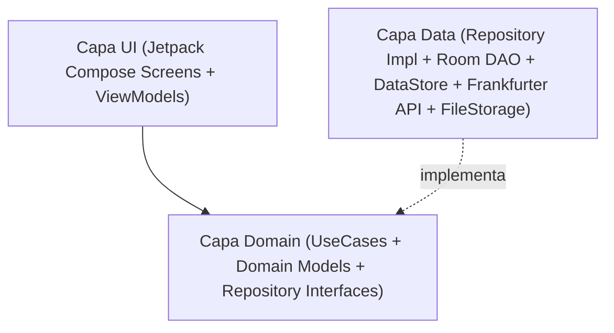

# Análisis Técnico: Arquitectura Android, Stack Tecnológico y Estrategia TDD

Este documento recoge la fase de **Análisis** del flujo SDD para traducir las especificaciones [`SPEC-00`](../specs/00-core-configuration-spec.md), [`SPEC-01`](../specs/01-world-clock-spec.md), [`SPEC-02`](../specs/02-currency-converter-spec.md), [`SPEC-03`](../specs/03-documents-and-id-vault-spec.md), [`SPEC-04`](../specs/04-trip-planner-spec.md), [`SPEC-05`](../specs/05-flight-planner-spec.md) y [`SPEC-06`](../specs/06-gemini-ai-and-translator-spec.md) en una arquitectura sólida, desacoplada y 100% verificable mediante TDD.

---

## 1. Stack Tecnológico

- **Lenguaje**: Kotlin 2.x (Coroutines + Flow + Kotlin Serialization).
- **SDK de Android**:
  - `minSdk`: 26 (Android 8.0, soporte nativo completo de `java.time` y `PdfRenderer`).
  - `targetSdk` / `compileSdk`: 35 (Android 15).
- **UI, Sistema de Diseño (`KotlinConf` Blueprint + Colores de Japón) y Diseño Adaptativo**:
  - **Jetpack Compose + Material Design 3 + Navigation Compose (Type-Safe Navigation)**.
  - **Template Visual basado en [`JetBrains/kotlinconf-app`](https://jetbrains.github.io/kotlinconf-app/)**:
    - Arquitectura de Design System modular (`JapanTravelTheme`) inspirada en los componentes de KotlinConf App: tarjetas con bordes definidos (`1.dp`), chips de filtrado estilo agenda de conferencia (ideales para el Planificador de Viaje por días/horarios y filtro de Guías por ciudad), cabeceras colapsables limpias y tipografía con dígitos tabulares (`fontFeatureSettings = "tnum"`) para relojes y divisas.
    - **Paleta de Colores de Japón (`Nippon Dentōshoku`)**:
      - *Primary*: `Akabeni / Torii Red` (`#C9171E` Light / `#FF5A5F` Dark).
      - *Secondary*: `Ai-iro Japanese Indigo` (`#165E83` Light / `#64B5F6` Dark).
      - *Tertiary*: `Matcha Green` (`#5B8930` Light / `#81C784` Dark) & `Sakura Pink` (`#F4A7B9`).
      - *Surfaces*: Papel cálido `Washi` (`#FAF7F2` / `#FFFFFF`) en modo Claro y tinta `Sumi` (`#0F1115` / `#181B22`) en modo Oscuro.
    - **Iconografía Moderna, Adaptive Icon y Splash Screen**:
      - Conjunto de iconos vectoriales modernos (`ImageVector` / `VectorDrawable` estilo *Material Symbols Rounded / Lucide* en sintonía con `kotlinconf-app`).
      - **Adaptive Launcher Icon** (`ic_launcher.xml` con capas `background`, `foreground` y `monochrome` para soporte completo de iconos temáticos en el Pixel Launcher de los Pixel 9/10 Pro XL).
      - **AndroidX Core SplashScreen (`androidx.core:core-splashscreen`)** sincronizada con la carga inicial de `UserPreferencesRepository` (DataStore) para aplicar el idioma y el tema Claro/Oscuro antes del primer fotograma de Compose.
  - **Material 3 Adaptive (`androidx.compose.material3.adaptive:adaptive`, `adaptive-layout`, `adaptive-navigation`, `material3-adaptive-navigation-suite`)** + **`WindowSizeClass`**:
    - Optimización específica para **Google Pixel 10 Pro XL / Pixel 9 Pro XL** (`Compact` width, pantallas altas 20:9 de 6.8" 1344x2992 a 120Hz, `enableEdgeToEdge()`, controles en zona inferior del pulgar).
    - Optimización específica para **Tablet TCL NXTPAPER 11 Plus** (`Medium` / `Expanded` width, 11.5" 2200x1440 ratio 3:2 a 120Hz): uso de `NavigationSuiteScaffold` (`NavigationRail`), `SupportingPaneScaffold` en el Planificador (Horario + Mapa Google Maps simultáneos) y `ListDetailPaneScaffold` en Documentos y Guías de Viaje, donde el estilo de bordes definidos `1.dp` de `kotlinconf-app` y el fondo *Washi* encajan de forma nativa con la pantalla mate estilo papel de NXTPAPER.
- **Mapas y Ubicación**:
  - **Google Maps SDK for Android + Maps Compose (`com.google.maps.android:maps-compose`)** para el mapa interactivo embebido en el planificador con marcadores numerados y polilíneas de ruta diaria.
  - **Google Maps Intents / Geo URIs** para lanzar navegación paso a paso y abrir fichas en la app nativa de Google Maps (compatible con mapas offline descargados en Google Maps).
  - **LocationManager / FusedLocationProvider** + resolutor offline de huso horario por coordenadas.
- **Calendario y Notificaciones**:
  - Calendario y línea temporal nativos en Compose + integración opcional con **`Android CalendarContract`** / Intents con zona horaria forzada a `Asia/Tokyo` y recordatorios vía `WorkManager` / `AlarmManager`.
- **Inyección de Dependencias**: Hilt (Dagger) o Koin / Manual DI modular (fácilmente reemplazable en tests unitarios con Fakes).
- **Persistencia Local (Offline-First) y Sincronización Multi-Dispositivo con Cuenta de Google**:
  - **Jetpack DataStore (Preferences)**: Idioma, tema visual, configuración de reloj de origen, divisas por defecto, flag de bloqueo biométrico, estado de cuenta de Google y timestamp de última sincronización en la nube.
  - **Jetpack Room (SQLite)**:
    - Caché persistente de tipos de cambio de divisas (`CurrencyRateEntity`).
    - Metadatos del repositorio de documentos e identificación (`TravelDocumentEntity`).
    - Guías de viaje importadas y creadas en la app (`TravelGuideEntity`, `GuidePhotoEntity`).
    - Planificador de viaje, días, horarios/paradas, ubicaciones y galería de fotos por parada (`TripEntity`, `TripDayEntity`, `ItineraryItemEntity`, `ItineraryPhotoEntity`).
    - Transporte multimodal (`TransportJourneyEntity`, `TransportSegmentEntity`) e historial de IA/Traducción (`AiMessageEntity`, `SavedTranslationEntity`).
    - *Campos de sincronización en todas las entidades*: `updatedAtMillis: Long`, `isDeleted: Boolean` (soft-delete para propagar borrados entre dispositivos) y `syncStatus: SyncStatus` (`SYNCED`, `PENDING_UPLOAD`).
  - **Almacenamiento Interno (`Context.filesDir`)**: Archivos físicos `.jpg`, `.png`, `.pdf`, `.md` del pasaporte, DNI, reservas, guías y fotos del planificador.
  - **Sincronización Cloud con Cuenta de Google (`Credential Manager API` + `Google Drive API appDataFolder` + `WorkManager`)**:
    - Autenticación nativa mediante `androidx.credentials:credentials` + `googleid`.
    - Sincronización automática bidireccional entre dispositivos (ej. **Pixel 10/9 Pro XL <-> Tablet TCL NXTPAPER 11 Plus**) almacenando el snapshot de base de datos y los archivos adjuntos en el espacio privado de aplicación (`appDataFolder`) de Google Drive del usuario (sin costes de servidor externo y 100% privado de su cuenta de Google), descargando siempre copia local completa para uso offline.
- **Red (Con Caché Offline)**:
  - **Ktor Client** o **Retrofit + OkHttp + Kotlinx Serialization** contra `https://api.frankfurter.dev/v1/`.
- **Inteligencia Artificial (Google Gemini) y Traducción Simultánea Offline**:
  - **Google GenAI / Gemini REST API (`gemini-2.0-flash` / `gemini-1.5-flash`) + Motor Experto On-Device Offline (`GeminiAssistantEngine`)**:
    - **Soporte Híbrido**: Consultas a la API de Gemini Cloud cuando hay conexión y API Key configurada (guardada de forma segura en `UserPreferencesRepository`), con fallback transparente e instantáneo al motor experto on-device offline.
    - **Retroalimentación Reactiva de UI**: Gestión de estado asíncrono con corrutinas (`isLoading`, `CircularProgressIndicator`, bloqueo de doble toque) e insignia de procedencia (`Gemini Cloud` vs `Experto Offline`) y hora de respuesta.
    - **Acciones Rápidas**: Copiado al portapapeles con confirmación visual, exportación directa a la Bóveda de Guías (`SharedDocumentsAndGuidesStore.createGuide`) e inyección al itinerario (`AiPlanBuilderEngine`).
  - **Google ML Kit On-Device Translation (`com.google.mlkit:translate`) + Text Recognition Japanese (`com.google.mlkit:text-recognition-japanese`)**: Traducción simultánea 100% offline `ES/EN <-> JA` y OCR de caracteres japoneses (`Kanji/Kana`), combinados con `SpeechRecognizer` y `TextToSpeech` de Android para conversación en vivo cara a cara.
- **Seguridad, Licencias Open Source e Internacionalización**:
  - **AndroidX Biometric (`BiometricPrompt`)** para protección de Pasaporte/DNI.
  - **AndroidX AppCompat (`AppCompatDelegate.setApplicationLocales`)** para soporte nativo multiidioma por aplicación (`es`, `en`).
  - **AboutLibraries (`com.mikepenz:aboutlibraries-compose-m3`)**: Plugin de Gradle que inspecciona automáticamente el árbol de dependencias en tiempo de compilación y empaqueta un JSON local en el APK con todas las librerías open source de terceros, autores, versiones y textos de licencia para mostrarlos 100% offline en Material Design 3.

---

## 2. Arquitectura (Clean Architecture + MVVM / UDF)

El código se estructura en tres capas claramente separadas con flujo de datos unidireccional (UDF):



### Estructura de Paquetes (`com.laralbir.japantraveltools`)
- `core/`
  - `designsystem/`: Tema Material 3 (Claro/Oscuro/Sistema), tipografía, componentes reutilizables, badge `BETA`.
  - `i18n/`: Gestión de idioma (Sistema -> `es`/`en` con fallback a `en`).
  - `database/`: Configuración de `RoomDatabase`.
  - `datastore/`: `UserPreferencesRepository` (DataStore).
  - `network/`: Cliente HTTP para Frankfurter API + `NetworkMonitor` (`ConnectivityManager.NetworkCallback`, `TelephonyManager`, `SubscriptionManager`) para detectar en tiempo real el estado y tipo de conexión (`WIFI`, `CELLULAR_ESIM`, `CELLULAR_SIM`, `ETHERNET`, `OFFLINE`, estado `isMetered` y `isRoaming`) y lanzar los paneles nativos de cambio rápido (`Settings.Panel.ACTION_INTERNET_CONNECTIVITY`, ajustes de SIM/eSIM).
- `feature/settings/`: Pantalla y ViewModel de ajustes globales (idioma, tema, biometría) + pantallas `AboutScreen` (versión de la app `BuildConfig.VERSION_NAME` / `VERSION_CODE`) y `OpenSourceLicensesScreen` (listado completo de librerías de terceros).
- `feature/clock/`:
  - `domain/`: `GetWorldClocksUseCase`, `ResolveTimeZoneFromLocationUseCase`, modelo `ClockComparison`.
  - `data/`: `LocationProvider`, `OfflineTimeZoneResolver`.
  - `ui/`: `WorldClockScreen`, `WorldClockViewModel`.
- `feature/currency/`:
  - `domain/`: `ConvertCurrencyUseCase`, `SyncExchangeRatesUseCase`, `CurrencyRepository`.
  - `data/`: `FrankfurterApiService`, `CurrencyRateDao`, `SeedExchangeRates`.
  - `ui/`: `CurrencyConverterScreen`, `CurrencyConverterViewModel`.
- `feature/documents/`:
  - `domain/`: `SaveIdentityImageUseCase`, `ImportTravelDocumentUseCase`, `GetTravelDocumentsUseCase`, `ManageTravelGuidesUseCase`, `DocumentRepository`, `TravelGuideRepository`.
  - `data/`: `TravelDocumentDao`, `TravelGuideDao`, `InternalFileStorageManager`, `BiometricAuthManager`.
  - `ui/`: `DocumentsVaultScreen`, `PassportDniViewerScreen`, `PdfViewerScreen`, `TravelGuidesScreen`, `GuideEditorScreen`, `DocumentsViewModel`.
- `feature/planner/`:
  - `domain/`: `CreateTripUseCase`, `ScheduleItineraryItemUseCase`, `DetectScheduleConflictsUseCase`, `ParseGoogleMapsUrlUseCase`, `ExportToSystemCalendarUseCase`, `TripPlannerRepository`.
  - `data/`: `TripPlannerDao`, `SystemCalendarExporter`, `GoogleMapsIntentLauncher`.
  - `ui/`: `TripPlannerScreen`, `DayTimelineView`, `DayEmbeddedMapView`, `ItineraryItemEditorSheet`, `TripPlannerViewModel`.
- `feature/transport/` (Planificador Multimodal: Vuelos, Trenes/Shinkansen, Metros y Autobuses):
  - `domain/`: `CalculateTransportTimelineUseCase`, `CalculateLayoverAndTransferUseCase`, `TransportPlannerRepository`, modelos `TransportJourney`, `TransportSegment`, `TransportType` (`FLIGHT`, `TRAIN_SHINKANSEN`, `TRAIN_EXPRESS`, `TRAIN_LOCAL`, `SUBWAY_METRO`, `BUS_HIGHWAY`, `BUS_LOCAL`, `BUS_AIRPORT`), `ConnectionDetails`.
  - `data/`: `TransportPlannerDao`, `AirportAndStationCatalog` (catálogo offline de aeropuertos internacionales/japoneses `MAD`, `BCN`, `DOH`, `HND`, `NRT`, `KIX` y principales estaciones de Japón como `Tokyo`, `Shinjuku`, `Shibuya`, `Kyoto`, `Shin-Osaka`, `Kanazawa`, `Hiroshima` con sus `ZoneId`, nombres en japonés y coordenadas).
  - `ui/`: `TransportPlannerScreen`, `FlightSegmentTimelineCard`, `TrainMetroBusSegmentCard`, `LayoverTransferConnectorCard`, `TransportEditorSheet`, `TransportPlannerViewModel`.
- `feature/ai_translator/` (Asistente IA Gemini y Acceso Directo a Traducción Simultánea):
  - `domain/`: `AskGeminiAssistantUseCase`, `AnalyzeJapaneseImageWithGeminiUseCase`, `SimultaneousTranslateUseCase`, `TransliterateToRomajiUseCase`, `AiAssistantRepository`, `OfflineTranslatorRepository`.
  - `data/`: `GeminiClientAdapter`, `MlKitOfflineTranslator`, `JapaneseOcrProcessor`, `AiConversationDao`.
  - `ui/`: `SimultaneousTranslatorScreen` (modo conversación cara a cara 180° + cámara OCR + acceso directo global), `GeminiAssistantScreen`, `AiTranslatorViewModel`.

---

## 3. Diseño de Datos y Contratos Principales

### 3.1. Preferencias de Usuario (`UserPreferences`)
```kotlin
enum class AppThemeMode { SYSTEM, LIGHT, DARK }
enum class AppLanguage { SYSTEM, ENGLISH, SPANISH }

data class UserPreferences(
    val themeMode: AppThemeMode = AppThemeMode.SYSTEM,
    val language: AppLanguage = AppLanguage.SYSTEM,
    val originZoneId: String = "Europe/Madrid",
    val use24HourFormat: Boolean = true,
    val baseCurrency: String = "EUR",
    val targetCurrency: String = "JPY",
    val customExchangeRate: Double? = null,
    val biometricLockEnabled: Boolean = false
)
```

### 3.2. Caché de Divisas (`CurrencyRateEntity` & `ExchangeRateSnapshot`)
- **Tabla Room `exchange_rates`**:
  - `baseCurrency: String` (ej. `"EUR"`)
  - `targetCurrency: String` (ej. `"JPY"`)
  - `rate: Double` (ej. `163.45`)
  - `rateDate: String` (fecha oficial BCE, ej. `"2026-10-25"`)
  - `lastSyncedEpochMillis: Long`
  - `isSeedData: Boolean` (indica si es la tasa semilla preinstalada o ya actualizada de red)

### 3.3. Documentos, Identificación y Guías de Viaje (`TravelDocumentEntity` & `TravelGuideEntity`)
- **Tabla Room `travel_documents`**:
  - `id: String` (UUID)
  - `title: String`
  - `category: DocumentCategory` (`PASSPORT`, `NATIONAL_ID_FRONT`, `NATIONAL_ID_BACK`, `FLIGHT`, `HOTEL`, `TRANSPORT`, `INSURANCE`, `TICKET`, `GUIDE`, `OTHER`)
  - `internalFilePath: String` (ruta relativa dentro de `filesDir`)
  - `mimeType: String` (`image/jpeg`, `application/pdf`, `text/markdown`, etc.)
  - `documentNumberOrNotes: String?`
  - `lastReadPage: Int` (para recordar la página en guías PDF)
  - `eventDateMillis: Long?`
  - `isPinned: Boolean`
  - `createdAtMillis: Long`
- **Tabla Room `travel_guides` (Guías nativas e importadas)**:
  - `id: String` (UUID)
  - `title: String`
  - `regionCity: String` (ej. `"Tokyo"`, `"Kyoto"`, `"Osaka"`, `"General"`)
  - `tagsCsv: String` (ej. `"Ramen,Shinjuku,Compras"`)
  - `markdownContent: String` (contenido enriquecido editable offline)
  - `attachedDocumentId: String?` (FK opcional a `travel_documents` si es un PDF/mapa importado)
  - `photoPathsJson: String` (lista de rutas internas en `filesDir/guides/`)
  - `isPinned: Boolean`
  - `updatedAtMillis: Long`

### 3.4. Planificador de Viaje, Horarios, Fotos y Ubicación (`TripEntity` & `ItineraryItemEntity`)
- **Tabla Room `trips`**:
  - `id: String` (UUID)
  - `name: String` (ej. `"Japón Otoño 2026"`)
  - `startDateIso: String` (`"2026-11-10"`)
  - `endDateIso: String` (`"2026-11-24"`)
- **Tabla Room `itinerary_items` (Actividades / Paradas por Día y Horario)**:
  - `id: String` (UUID)
  - `tripId: String` (FK a `trips`)
  - `dateIso: String` (`"2026-11-10"`)
  - `startTimeIso: String` (`"09:00"`, interpretado siempre en `Asia/Tokyo`)
  - `endTimeIso: String?` (`"11:00"`)
  - `title: String` (ej. `"Visitar Templo Senso-ji"`)
  - `category: StopCategory` (`SIGHTSEEING`, `FOOD`, `TRANSPORT`, `HOTEL`, `SHOPPING`, `ACTIVITY`)
  - `notes: String?`
  - `placeNameJapanese: String?` (ej. `"浅草寺"` para mostrar offline o buscar)
  - `address: String?`
  - `latitude: Double?`
  - `longitude: Double?`
  - `googleMapsUrl: String?`
  - `photoPathsJson: String` (lista de fotos en `filesDir/planner_photos/`)
  - `linkedDocumentId: String?` (FK opcional a reserva/entrada en `travel_documents`)
  - `linkedGuideId: String?` (FK opcional a guía en `travel_guides`)
  - `syncedCalendarEventId: Long?` (ID en `CalendarContract` si fue exportado)

### 3.5. Planificador de Transporte Multimodal: Vuelos, Trenes, Metros y Autobuses (`TransportJourneyEntity` & `TransportSegmentEntity`)
- **Tabla Room `transport_journeys`** (Agrupador de trayecto, ej. *Ida a Japón: Avión + Narita Express + Metro* o *Ruta Tokio ➔ Kioto ➔ Nara*):
  - `id: String` (UUID)
  - `tripId: String?` (FK opcional a `trips`)
  - `title: String` (ej. `"Llegada a Tokio: Vuelo + N'EX + Metro"`)
  - `bookingReferencePnr: String?`
- **Tabla Room `transport_segments`** (Cada tramo individual de Vuelo, Tren, Metro o Autobús):
  - `id: String` (UUID)
  - `journeyId: String` (FK a `transport_journeys`)
  - `segmentOrder: Int` (`0`, `1`, `2`...)
  - `transportType: TransportType` (`FLIGHT`, `TRAIN_SHINKANSEN`, `TRAIN_EXPRESS`, `TRAIN_LOCAL`, `SUBWAY_METRO`, `BUS_HIGHWAY`, `BUS_LOCAL`, `BUS_AIRPORT`)
  - `operatorOrAirline: String` (ej. `"Qatar Airways"`, `"JR Central"`, `"Tokyo Metro"`, `"Keio Bus"`)
  - `lineOrFlightNumber: String` (ej. `"QR806"`, `"Nozomi #21"`, `"Ginza Line (G)"`, `"Bus #206"`)
  - `lineColorHex: String?` (color identificativo de la línea de metro/tren, ej. `"#FF9500"`)
  - `departureStationOrAirportCode: String` (IATA `"MAD"` / `"NRT"` o código de estación `"G19"` / `"TYO"`)
  - `departurePlaceName: String` (ej. `"Madrid Barajas"` o `"Tokyo Station (東京駅)"`)
  - `departureZoneId: String` (ej. `"Europe/Madrid"`, `"Asia/Tokyo"`)
  - `departureTerminalOrPlatform: String?` (Terminal `"T4S"` en vuelos, Andén `"Track 16"` en tren/metro, o Dársena `"Bay 4"` en autobús)
  - `checkInCounterOrStationGate: String?` (Mostrador de facturación o Entrada de estación)
  - `boardingGate: String?` (Puerta de embarque en vuelos)
  - `carNumber: String?` (Número de vagón/coche en Shinkansen o vagón recomendado en Metro para transbordo)
  - `seatNumber: String?` (Asiento `"18K"`, `"12E (Fuji View)"` o `"Non-Reserved / 自由席"`)
  - `oversizedBaggageReserved: Boolean` (Reserva de espacio para maletas grandes en Shinkansen)
  - `passOrPaymentType: String?` (`"JR Pass"`, `"Suica / IC Card"`, `"Billete Reservado"`, `"Efectivo"`)
  - `onlineCheckInOpensIso: String?` (Vuelos)
  - `counterCheckInTimeIso: String?` (Hora de facturación en aeropuerto / llegada al andén)
  - `bagDropDeadlineIso: String?` (Cierre de facturación de maletas)
  - `boardingTimeIso: String?` (Hora de embarque)
  - `departureTimeIso: String` (Hora de salida local en `departureZoneId`)
  - `arrivalStationOrAirportCode: String` (ej. `"HND"`, `"KYO"`, `"G01"`)
  - `arrivalPlaceName: String`
  - `arrivalZoneId: String` (ej. `"Asia/Tokyo"`)
  - `arrivalTerminalOrPlatform: String?` (Terminal de llegada, Andén de llegada o Parada)
  - `stationExitNumber: String?` (Salida exacta de estación de metro/tren, ej. `"Salida A4"`, `"Hachiko Exit"`)
  - `baggageClaimBelt: String?` (Cinta de equipaje en vuelos)
  - `arrivalTimeIso: String` (Hora de llegada local en `arrivalZoneId`)
  - `ticketDocumentId: String?` (FK opcional a tarjeta de embarque o billete QR en `travel_documents`)
  - `notes: String?`

### 3.6. Asistente IA Gemini y Caché de Traducciones (`AiMessageEntity` & `SavedTranslationEntity`)
- **Tabla Room `ai_messages`** (Historial persistente offline de consultas y análisis de imágenes con Gemini):
  - `id: String` (UUID)
  - `sessionId: String`
  - `role: String` (`"USER"` o `"MODEL"`)
  - `promptOrResponseMarkdown: String`
  - `attachedImagePath: String?` (ruta en `filesDir/ai_photos/` p. ej. foto de menú japonés)
  - `createdAtMillis: Long`
- **Tabla Room `saved_translations`** (Frases frecuentes, alergias e historial de traducción simultánea offline):
  - `id: String` (UUID)
  - `sourceLanguage: String` (`"es"`, `"en"`)
  - `sourceText: String`
  - `japaneseText: String` (`Kanji/Kana`)
  - `romajiText: String` (pronunciación fonética)
  - `isPinnedPhrase: Boolean`

### 3.7. Portabilidad JSON Legible (`TravelPlanJsonCodec`) y Constructor/Optimizador IA (`AiPlanBuilderEngine`)
- **`PortableTravelPlanBundle` (`schemaVersion = "japan-travel-plan.v1"`)**:
  - Contenedor unificado que agrupa el itinerario completo por días/horarios (`itineraryStops`) junto con todos los tramos de transporte multimodal (`transportSegments`: vuelos, Shinkansen, metro y autobuses) y el resumen de optimización de IA (`aiOptimizationSummary`).
  - `TravelPlanJsonCodec` serializa y deserializa el paquete a **JSON indentado (pretty-printed, 2 espacios)** 100% legible por humanos, permitiendo preparar viajes en aplicaciones externas (PC/Web/LLM) e importarlos mediante **Fusión inteligente (`mergePlans`)** o **Reemplazo completo**.
- **`AiPlanBuilderEngine` + `SharedTravelPlanStore`**:
  - Flujo reactivo (`StateFlow<PortableTravelPlanBundle>`) compartido entre el Planificador de Viaje, el Planificador de Transporte y el Asistente IA Gemini.
  - Permite que la IA integrada **cree nuevos planes de viaje** y **mejore los planes existentes en la app** (resolviendo solapamientos horarios y añadiendo nuevas jornadas y conexiones de Shinkansen/vuelo).

### 3.8. Previsión Meteorológica con Open-Meteo para Planificación de Usuario e IA (`OpenMeteoWeatherUseCase`)
- **Fuente Open-Source**: API REST pública de **Open-Meteo (`https://api.open-meteo.com/v1/forecast`)** con soporte de modelos globales y de la **JMA (Japan Meteorological Agency)** en huso horario `Asia/Tokyo`, sin necesidad de API Key.
- **Modelo de Dominio y Gestión Dinámica de Ciudades (`WeatherCityItem`, `WeatherDayForecast`, `WeatherConditionKind`, `PlanningSuitability`)**:
  - `WeatherCityItem`: Entidad que define cualquier ciudad o destino con identificador único, nombre multilingüe (`nameEs`, `nameEn`), coordenadas (`latitude`, `longitude`) y marca de ciudad por defecto.
  - Catálogo de presets de destinos de Japón (Nara, Hiroshima, Miyajima, Kamakura, Nikko, Takayama, Kanazawa, Sapporo, Fukuoka, Nagoya, Yokohama, Kobe, Okinawa, Sendai) para alta inmediata sin buscar coordenadas manualmente.
  - CRUD reactivo en `SharedWeatherForecastStore` (`addCity`, `updateCity`, `deleteCity`) con serialización en `Context.filesDir/saved_weather_cities.json`.
  - Clasifica códigos WMO (`0..99`) en estados accionables (`CLEAR_SUNNY`, `PARTLY_CLOUDY`, `RAIN`, `SNOW`, `HEAVY_RAIN_STORM`).
  - Evalúa cada día en `OUTDOOR_OPTIMAL` (ideal para templos, parques, santuarios al aire libre y vistas del Monte Fuji) o `INDOOR_RECOMMENDED` (recomendado priorizar mercados cubiertos como Nishiki/Kuromon, museos o galerías comerciales *Shotengai*).
  - Incluye semillas climáticas offline (`SeedJapanWeatherCatalog`) para Tokio, Kioto, Osaka, Hakone/Monte Fuji, Nara e Hiroshima, garantizando funcionamiento 100% offline.
- **Integración con la IA (`AiPlanBuilderEngine.optimizePlanWithWeather`)**:
  - Cruza las fechas de cada día del itinerario con las previsiones de Open-Meteo y enriquece automáticamente las paradas del viaje y las respuestas del asistente Gemini con recomendaciones climáticas y alternativas cubiertas en días lluviosos.

---

## 4. Estrategia de Testing (TDD)

Cada funcionalidad sigue el ciclo **Red -> Green -> Refactor**:

1. **Tests Unitarios de Dominio y Datos (`src/test/java`)**:
   - **JUnit 5 / JUnit 4 + Kotlin Coroutines Test (`runTest`) + Turbine (para Flows)**.
   - Verificación sin emulador de:
     - Resolución de idioma con fallback a `ENGLISH` cuando el locale del sistema no es `es` ni `en`.
     - Cálculo de diferencia horaria entre `Asia/Tokyo`, ubicación GPS simulada y `Europe/Madrid` (incluyendo cambios de horario de verano/invierno DST).
     - Conversión bidireccional `EUR <-> JPY`, aplicación de tasas semilla cuando no hay red, actualización de caché con Frankfurter API simulada (`MockEngine` / Fake API) y supervivencia de datos en modo offline.
     - Filtrado, categorización, alta y borrado de documentos de viaje, guías personalizadas/importadas y fotos de Pasaporte/DNI usando un `FakeFileStorageManager`.
     - Lógica del **Planificador de Viaje**: generación de días entre fechas, ordenación cronológica de horarios, detección de solapamientos (`DetectScheduleConflictsUseCase`), extracción de coordenadas desde enlaces de Google Maps (`ParseGoogleMapsUrlUseCase`) y conversión de horarios a `Asia/Tokyo` para exportación a calendario.
     - Lógica del **Planificador de Transporte Multimodal (`SPEC-05` — Vuelos, Trenes, Metros y Autobuses)**: cálculo exacto de duración real de cada tramo aéreo o terrestre entre distintas zonas horarias (`CalculateTransportTimelineUseCase`), cálculo de tiempo de escala aérea y tiempo de transbordo entre avión/tren/metro/autobús (`CalculateLayoverAndTransferUseCase`), detección de alertas de escala o transbordo ajustado y cálculo de diferencia de días (`+1 día` / `+2 días`).
     - Lógica del **Sistema de Alertas de Facturación, Embarque y Salida (`SPEC-05 RF-05.5`)**: `TransportAlertEvaluator` (evaluación de umbrales para `CHECK_IN_APPROACHING`, `CHECK_IN_OPEN`, `BOARDING_APPROACHING`, `BOARDING_NOW`, `DEPARTURE_IMMINENT`), descarte temporal de alertas, formato de títulos y mensajes bilingües (ES/EN) y cálculo de minutos restantes según el huso horario del tramo (`java.time.ZonedDateTime`).
     - Despacho y canal de notificaciones Android (`TransportAlertNotificationHelper`): canal `transport_alerts` con importancia alta, compatibilidad con Android 13+ (`POST_NOTIFICATIONS`) y `SharedTransportAlertStore` con simulación interactiva para pruebas sin esperar a la fecha del vuelo.
     - Inicialización limpia de tramos de transporte (`TransportPlannerUseCase.createEmptySegment`): aislamiento reactivo en Compose mediante claves de estado (`initialSegment.id`) y apertura con todos los inputs de texto limpios (`""`) al pulsar `➕ Añadir Transporte`.
     - Extracción y sincronización de ciudades del tiempo (`PlanWeatherCityExtractor` & `SharedWeatherForecastStore.syncCitiesFromPlan`): detección automática de ciudades y aeropuertos a partir de los orígenes y destinos de transporte (`TransportSegmentItem`) y de las paradas de la agenda de viaje (`ItineraryStopItem`), con memoria de exclusión de eliminaciones manuales (`deletedCityIds`) y persistencia offline.
     - Componente universal de seguridad para el usuario (`AppConfirmationDialog`): prevención de pérdidas accidentales de datos en acciones de edición y eliminación (`isDestructive`) para transportes, planes, paradas, documentos, guías y ciudades.
2. **Tests de UI / Instrumentados (`src/androidTest/java`)**:
   - **Compose UI Test (`createComposeRule`) + Room In-Memory Database**.
   - Verificación de navegación, cambio de tema Claro/Oscuro, interacción con el conversor, selector de zona horaria de origen, creación/lectura de guías de viaje y línea temporal/mapa del planificador.
