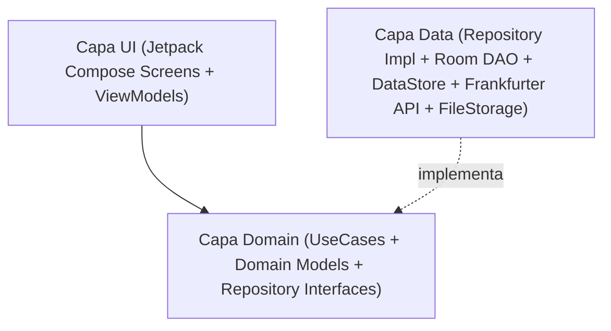

# Análisis Técnico: Arquitectura Android, Stack Tecnológico y Estrategia TDD

Este documento recoge la fase de **Análisis** del flujo SDD para traducir las especificaciones [`SPEC-00`](../specs/00-core-configuration-spec.md), [`SPEC-01`](../specs/01-world-clock-spec.md), [`SPEC-02`](../specs/02-currency-converter-spec.md), [`SPEC-03`](../specs/03-documents-and-id-vault-spec.md), [`SPEC-04`](../specs/04-trip-planner-spec.md), [`SPEC-05`](../specs/05-flight-planner-spec.md) y [`SPEC-06`](../specs/06-gemini-ai-and-translator-spec.md) en una arquitectura sólida, desacoplada y 100% verificable mediante TDD.

---

## 1. Stack Tecnológico

- **Lenguaje**: Kotlin 2.x (Coroutines + Flow + Kotlin Serialization).
- **SDK de Android**:
  - `minSdk`: 26 (Android 8.0, soporte nativo completo de `java.time` y `PdfRenderer`).
  - `targetSdk` / `compileSdk`: 35 (Android 15).
- **UI, Sistema de Diseño (`KotlinConf` Blueprint + Colores de Japón) y Diseño Adaptativo**:
  - **Jetpack Compose + Material Design 3 + Navigation Compose (Type-Safe Navigation)**.
  - **Template Visual basado en [`JetBrains/kotlinconf-app`](https://jetbrains.github.io/kotlinconf-app/)**:
    - Arquitectura de Design System modular (`JapanTravelTheme`) inspirada en los componentes de KotlinConf App: tarjetas con bordes definidos (`1.dp`), chips de filtrado estilo agenda de conferencia (ideales para el Planificador de Viaje por días/horarios y filtro de Guías por ciudad), cabeceras colapsables limpias y tipografía con dígitos tabulares (`fontFeatureSettings = "tnum"`) para relojes y divisas.
    - **Paleta de Colores de Japón (`Nippon Dentōshoku`)**:
      - *Primary*: `Akabeni / Torii Red` (`#C9171E` Light / `#FF5A5F` Dark).
      - *Secondary*: `Ai-iro Japanese Indigo` (`#165E83` Light / `#64B5F6` Dark).
      - *Tertiary*: `Matcha Green` (`#5B8930` Light / `#81C784` Dark) & `Sakura Pink` (`#F4A7B9`).
      - *Surfaces*: Papel cálido `Washi` (`#FAF7F2` / `#FFFFFF`) en modo Claro y tinta `Sumi` (`#0F1115` / `#181B22`) en modo Oscuro.
    - **Iconografía Moderna, Adaptive Icon y Splash Screen**:
      - Conjunto de iconos vectoriales modernos (`ImageVector` / `VectorDrawable` estilo *Material Symbols Rounded / Lucide* en sintonía con `kotlinconf-app`).
      - **Adaptive Launcher Icon** (`ic_launcher.xml` con capas `background`, `foreground` y `monochrome` para soporte completo de iconos temáticos en el Pixel Launcher de los Pixel 9/10 Pro XL).
      - **AndroidX Core SplashScreen (`androidx.core:core-splashscreen`)** sincronizada con la carga inicial de `UserPreferencesRepository` (DataStore) para aplicar el idioma y el tema Claro/Oscuro antes del primer fotograma de Compose.
  - **Material 3 Adaptive (`androidx.compose.material3.adaptive:adaptive`, `adaptive-layout`, `adaptive-navigation`, `material3-adaptive-navigation-suite`)** + **`WindowSizeClass`**:
    - Optimización específica para **Google Pixel 10 Pro XL / Pixel 9 Pro XL** (`Compact` width, pantallas altas 20:9 de 6.8" 1344x2992 a 120Hz, `enableEdgeToEdge()`, controles en zona inferior del pulgar).
    - Optimización específica para **Tablet TCL NXTPAPER 11 Plus** (`Medium` / `Expanded` width, 11.5" 2200x1440 ratio 3:2 a 120Hz): uso de `NavigationSuiteScaffold` (`NavigationRail`), `SupportingPaneScaffold` en el Planificador (Horario + Mapa Google Maps simultáneos) y `ListDetailPaneScaffold` en Documentos y Guías de Viaje, donde el estilo de bordes definidos `1.dp` de `kotlinconf-app` y el fondo *Washi* encajan de forma nativa con la pantalla mate estilo papel de NXTPAPER.
- **Mapas y Ubicación**:
  - **Google Maps SDK for Android + Maps Compose (`com.google.maps.android:maps-compose`)** para el mapa interactivo embebido en el planificador con marcadores numerados y polilíneas de ruta diaria.
  - **Google Maps Intents / Geo URIs** para lanzar navegación paso a paso y abrir fichas en la app nativa de Google Maps (compatible con mapas offline descargados en Google Maps).
  - **LocationManager / FusedLocationProvider** + resolutor offline de huso horario por coordenadas.
- **Calendario y Notificaciones**:
  - Calendario y línea temporal nativos en Compose + integración opcional con **`Android CalendarContract`** / Intents con zona horaria forzada a `Asia/Tokyo` y recordatorios vía `WorkManager` / `AlarmManager`.
- **Inyección de Dependencias**: Hilt (Dagger) o Koin / Manual DI modular (fácilmente reemplazable en tests unitarios con Fakes).
- **Persistencia Local (Offline-First) y Sincronización Multi-Dispositivo con Cuenta de Google**:
  - **Jetpack DataStore (Preferences)**: Idioma, tema visual, configuración de reloj de origen, divisas por defecto, flag de bloqueo biométrico, estado de cuenta de Google y timestamp de última sincronización en la nube.
  - **Jetpack Room (SQLite)**:
    - Caché persistente de tipos de cambio de divisas (`CurrencyRateEntity`).
    - Metadatos del repositorio de documentos e identificación (`TravelDocumentEntity`).
    - Guías de viaje importadas y creadas en la app (`TravelGuideEntity`, `GuidePhotoEntity`).
    - Planificador de viaje, días, horarios/paradas, ubicaciones y galería de fotos por parada (`TripEntity`, `TripDayEntity`, `ItineraryItemEntity`, `ItineraryPhotoEntity`).
    - Transporte multimodal (`TransportJourneyEntity`, `TransportSegmentEntity`) e historial de IA/Traducción (`AiMessageEntity`, `SavedTranslationEntity`).
    - *Campos de sincronización en todas las entidades*: `updatedAtMillis: Long`, `isDeleted: Boolean` (soft-delete para propagar borrados entre dispositivos) y `syncStatus: SyncStatus` (`SYNCED`, `PENDING_UPLOAD`).
  - **Almacenamiento Interno (`Context.filesDir`)**: Archivos físicos `.jpg`, `.png`, `.pdf`, `.md` del pasaporte, DNI, reservas, guías y fotos del planificador.
  - **Sincronización Cloud con Cuenta de Google (`Credential Manager API` + `Google Drive API appDataFolder` + `WorkManager`)**:
    - Autenticación nativa mediante `androidx.credentials:credentials` + `googleid`.
    - Sincronización automática bidireccional entre dispositivos (ej. **Pixel 10/9 Pro XL <-> Tablet TCL NXTPAPER 11 Plus**) almacenando el snapshot de base de datos y los archivos adjuntos en el espacio privado de aplicación (`appDataFolder`) de Google Drive del usuario (sin costes de servidor externo y 100% privado de su cuenta de Google), descargando siempre copia local completa para uso offline.
- **Red (Con Caché Offline)**:
  - **Ktor Client** o **Retrofit + OkHttp + Kotlinx Serialization** contra `https://api.frankfurter.dev/v1/`.
- **Inteligencia Artificial (Google Gemini) y Traducción Simultánea Offline**:
  - **Google GenAI / Gemini REST API (`gemini-2.0-flash` / `gemini-1.5-flash`) + Motor Experto On-Device Offline (`GeminiAssistantEngine`)**:
    - **Soporte Híbrido**: Consultas a la API de Gemini Cloud cuando hay conexión y API Key configurada (guardada de forma segura en `UserPreferencesRepository`), con fallback transparente e instantáneo al motor experto on-device offline.
    - **Retroalimentación Reactiva de UI**: Gestión de estado asíncrono con corrutinas (`isLoading`, `CircularProgressIndicator`, bloqueo de doble toque) e insignia de procedencia (`Gemini Cloud` vs `Experto Offline`) y hora de respuesta.
    - **Acciones Rápidas**: Copiado al portapapeles con confirmación visual, exportación directa a la Bóveda de Guías (`SharedDocumentsAndGuidesStore.createGuide`) e inyección al itinerario (`AiPlanBuilderEngine`).
    - **Configuración Amigable de Clave de API (`GeminiApiKeyHelper` & `GeminiApiKeySetupCard`)**: Enlace directo a Google AI Studio (`aistudio.google.com/app/apikey`), guía visual en 4 pasos, botón de pegado automático desde el portapapeles de Android, conmutador de visibilidad (`👁️/🙈`) y validación de formato `AIzaSy...`.
  - **Google ML Kit On-Device Translation (`com.google.mlkit:translate`) + Text Recognition Japanese (`com.google.mlkit:text-recognition-japanese`)**: Traducción simultánea 100% offline `ES/EN <-> JA` y OCR de caracteres japoneses (`Kanji/Kana`), combinados con `SpeechRecognizer` y `TextToSpeech` de Android para conversación en vivo cara a cara.
- **Seguridad, Licencias Open Source e Internacionalización**:
  - **AndroidX Biometric (`BiometricPrompt`)** para protección de Pasaporte, DNI y Documentos Personalizados con tarjeta de seguridad dedicada e independiente (`🔒 Bloqueo Biométrico / PIN`).
  - **Bóveda de Documentos de Identidad Personalizados (`CustomIdDocumentItem`)**: almacenamiento privado de certificados de vacunas, recetas médicas para aduanas japonesas, carnet internacional de conducir, visados y pólizas en `Context.filesDir/id_vault/custom_id_docs.json` con soporte completo de zoom táctil, edición y borrado con doble check.
  - **AndroidX AppCompat (`AppCompatDelegate.setApplicationLocales`)** para soporte nativo multiidioma por aplicación (`es`, `en`).
  - **AboutLibraries (`com.mikepenz:aboutlibraries-compose-m3`)**: Plugin de Gradle que inspecciona automáticamente el árbol de dependencias en tiempo de compilación y empaqueta un JSON local en el APK con todas las librerías open source de terceros, autores, versiones y textos de licencia para mostrarlos 100% offline en Material Design 3.

---

## 2. Arquitectura (Clean Architecture + MVVM / UDF)

El código se estructura en tres capas claramente separadas con flujo de datos unidireccional (UDF):



### Estructura de Paquetes (`com.laralbir.japantraveltools`)
- `core/`
  - `designsystem/`: Tema Material 3 (Claro/Oscuro/Sistema), tipografía, componentes reutilizables, badge `BETA`.
  - `i18n/`: Gestión de idioma (Sistema -> `es`/`en` con fallback a `en`).
  - `database/`: Configuración de `RoomDatabase`.
  - `datastore/`: `UserPreferencesRepository` (DataStore).
  - `network/`: Cliente HTTP para Frankfurter API + `NetworkMonitor` (`ConnectivityManager.NetworkCallback`, `TelephonyManager`, `SubscriptionManager`) para detectar en tiempo real el estado y tipo de conexión (`WIFI`, `CELLULAR_ESIM`, `CELLULAR_SIM`, `ETHERNET`, `OFFLINE`, estado `isMetered` y `isRoaming`) y lanzar los paneles nativos de cambio rápido (`Settings.Panel.ACTION_INTERNET_CONNECTIVITY`, ajustes de SIM/eSIM).
- `feature/settings/`: Pantalla y ViewModel de ajustes globales (idioma, tema, biometría) + pantallas `AboutScreen` (versión de la app `BuildConfig.VERSION_NAME` / `VERSION_CODE`) y `OpenSourceLicensesScreen` (listado completo de librerías de terceros).
- `feature/clock/`:
  - `domain/`: `GetWorldClocksUseCase`, `ResolveTimeZoneFromLocationUseCase`, modelo `ClockComparison`.
  - `data/`: `LocationProvider`, `OfflineTimeZoneResolver`.
  - `ui/`: `WorldClockScreen`, `WorldClockViewModel`.
- `feature/currency/`:
  - `domain/`: `ConvertCurrencyUseCase`, `SyncExchangeRatesUseCase`, `CurrencyRepository`.
  - `data/`: `FrankfurterApiService`, `CurrencyRateDao`, `SeedExchangeRates`.
  - `ui/`: `CurrencyConverterScreen`, `CurrencyConverterViewModel`.
- `feature/documents/`:
  - `domain/`: `SaveIdentityImageUseCase`, `ImportTravelDocumentUseCase`, `GetTravelDocumentsUseCase`, `ManageTravelGuidesUseCase`, `DocumentRepository`, `TravelGuideRepository`.
  - `data/`: `TravelDocumentDao`, `TravelGuideDao`, `InternalFileStorageManager`, `BiometricAuthManager`.
  - `ui/`: `DocumentsVaultScreen`, `PassportDniViewerScreen`, `PdfViewerScreen`, `TravelGuidesScreen`, `GuideEditorScreen`, `DocumentsViewModel`.
- `feature/planner/`:
  - `domain/`: `CreateTripUseCase`, `ScheduleItineraryItemUseCase`, `DetectScheduleConflictsUseCase`, `ParseGoogleMapsUrlUseCase`, `ExportToSystemCalendarUseCase`, `TripPlannerRepository`.
  - `data/`: `TripPlannerDao`, `SystemCalendarExporter`, `GoogleMapsIntentLauncher`.
  - `ui/`: `TripPlannerScreen`, `DayTimelineView`, `DayEmbeddedMapView`, `ItineraryItemEditorSheet`, `TripPlannerViewModel`.
- `feature/transport/` (Planificador Multimodal: Vuelos, Trenes/Shinkansen, Metros y Autobuses):
  - `domain/`: `CalculateTransportTimelineUseCase`, `CalculateLayoverAndTransferUseCase`, `TransportPlannerRepository`, modelos `TransportJourney`, `TransportSegment`, `TransportType` (`FLIGHT`, `TRAIN_SHINKANSEN`, `TRAIN_EXPRESS`, `TRAIN_LOCAL`, `SUBWAY_METRO`, `BUS_HIGHWAY`, `BUS_LOCAL`, `BUS_AIRPORT`), `ConnectionDetails`.
  - `data/`: `TransportPlannerDao`, `AirportAndStationCatalog` (catálogo offline de aeropuertos internacionales/japoneses `MAD`, `BCN`, `DOH`, `HND`, `NRT`, `KIX` y principales estaciones de Japón como `Tokyo`, `Shinjuku`, `Shibuya`, `Kyoto`, `Shin-Osaka`, `Kanazawa`, `Hiroshima` con sus `ZoneId`, nombres en japonés y coordenadas).
  - `ui/`: `TransportPlannerScreen`, `FlightSegmentTimelineCard`, `TrainMetroBusSegmentCard`, `LayoverTransferConnectorCard`, `TransportEditorSheet`, `TransportPlannerViewModel`.
- `feature/ai_translator/` (Asistente IA Gemini y Acceso Directo a Traducción Simultánea):
  - `domain/`: `AskGeminiAssistantUseCase`, `AnalyzeJapaneseImageWithGeminiUseCase`, `SimultaneousTranslateUseCase`, `TransliterateToRomajiUseCase`, `AiAssistantRepository`, `OfflineTranslatorRepository`.
  - `data/`: `GeminiClientAdapter`, `MlKitOfflineTranslator`, `JapaneseOcrProcessor`, `AiConversationDao`.
  - `ui/`: `SimultaneousTranslatorScreen` (modo conversación cara a cara 180° + cámara OCR + acceso directo global), `GeminiAssistantScreen`, `AiTranslatorViewModel`.

---

## 3. Diseño de Datos y Contratos Principales

### 3.1. Preferencias de Usuario (`UserPreferences`)
```kotlin
enum class AppThemeMode { SYSTEM, LIGHT, DARK }
enum class AppLanguage { SYSTEM, ENGLISH, SPANISH }

data class UserPreferences(
    val themeMode: AppThemeMode = AppThemeMode.SYSTEM,
    val language: AppLanguage = AppLanguage.SYSTEM,
    val originZoneId: String = "Europe/Madrid",
    val use24HourFormat: Boolean = true,
    val baseCurrency: String = "EUR",
    val targetCurrency: String = "JPY",
    val customExchangeRate: Double? = null,
    val biometricLockEnabled: Boolean = true
)
```

#### Máquina de Estados de Autenticación de Bóveda (Bloqueo Obligatorio sin Toggle)
- **Bloqueo Obligatorio por Hardware**:
  - `isLockMandatory = VaultSecurityPolicy.isLockMandatory(biometricAvailable)`
  - Si el dispositivo soporta biometría/PIN (`biometricAvailable == true`), el bloqueo es **obligatorio y no deshabilitable**. No se expone ningún conmutador (toggle) en la UI.
  - `vaultUnlocked = remember { mutableStateOf(!isLockMandatory) }`: estado **efímero** (sin `rememberSaveable`). Si `isLockMandatory` es `true`, **siempre nace bloqueado (`false`)** mostrando la tarjeta "Identificación Bloqueada".
- **Apertura de Pantalla (`LaunchedEffect(isLockMandatory)`)**:
  - Si `isLockMandatory && !vaultUnlocked`: dispara `BiometricPrompt`.
  - Éxito: `vaultUnlocked = true`, `authErrorText = null`.
  - Fallo/Cancelación: `vaultUnlocked = false`, `authErrorText = errString`.
- **Auto-Bloqueo por Temporizador y Ciclo de Vida**:
  - **Temporizador de Sesión**: Cuando `vaultUnlocked == true` e `isLockMandatory == true`, una corrutina en `LaunchedEffect(vaultUnlocked)` espera 120 segundos (`120_000L`); al transcurrir el tiempo, ejecuta `vaultUnlocked = false`.
  - **Ciclo de Vida y Excepción de Selectores Externos**: Mediante `DisposableEffect` con `LifecycleEventObserver`, si el usuario sale de la aplicación a otra app (`ON_STOP`) o cambia de pantalla, `vaultUnlocked` se conmuta a `false`. Sin embargo, al invocar la cámara o el selector de archivos del sistema (`isLaunchingExternalPicker == true`), el ciclo de vida no bloquea la sesión para evitar que el modal biométrico interrumpa el flujo al regresar con la foto o el PDF.
- **Soporte Multiformato (PDF e Imagen) en Pasaporte y DNI**:
  - Tanto la tarjeta de Pasaporte como el DNI (anverso y reverso) soportan indistintamente fotos (`.jpg`, `.png`, `.webp`) y documentos **PDF** (`.pdf`).
  - Si el archivo es un PDF, la interfaz muestra la tarjeta interactiva con metadatos y acceso al visor de PDF externo. Si es una imagen, se renderiza con visor zoom táctil a pantalla completa.
- **Botón "Bloquear"**:
  - Mientras `vaultUnlocked == true`, se muestra de forma fija el botón de acción rápida `🔒 Bloquear`, permitiendo al usuario revocar el acceso y bloquear la pantalla de inmediato.

### 3.2. Caché de Divisas (`CurrencyRateEntity` & `ExchangeRateSnapshot`)
- **Tabla Room `exchange_rates`**:
  - `baseCurrency: String` (ej. `"EUR"`)
  - `targetCurrency: String` (ej. `"JPY"`)
  - `rate: Double` (ej. `163.45`)
  - `rateDate: String` (fecha oficial BCE, ej. `"2026-10-25"`)
  - `lastSyncedEpochMillis: Long`
  - `isSeedData: Boolean` (indica si es la tasa semilla preinstalada o ya actualizada de red)

### 3.3. Documentos, Identificación y Guías de Viaje (`TravelDocumentEntity` & `TravelGuideEntity`)
- **Tabla Room `travel_documents`**:
  - `id: String` (UUID)
  - `title: String`
  - `category: DocumentCategory` (`PASSPORT`, `NATIONAL_ID_FRONT`, `NATIONAL_ID_BACK`, `FLIGHT`, `HOTEL`, `TRANSPORT`, `INSURANCE`, `TICKET`, `GUIDE`, `OTHER`)
  - `internalFilePath: String` (ruta relativa dentro de `filesDir`)
  - `mimeType: String` (`image/jpeg`, `application/pdf`, `text/markdown`, etc.)
  - `documentNumberOrNotes: String?`
  - `lastReadPage: Int` (para recordar la página en guías PDF)
  - `eventDateMillis: Long?`
  - `isPinned: Boolean`
  - `createdAtMillis: Long`
- **Tabla Room `travel_guides` (Guías nativas e importadas)**:
  - `id: String` (UUID)
  - `title: String`
  - `regionCity: String` (ej. `"Tokyo"`, `"Kyoto"`, `"Osaka"`, `"General"`)
  - `tagsCsv: String` (ej. `"Ramen,Shinjuku,Compras"`)
  - `markdownContent: String` (contenido enriquecido editable offline)
  - `attachedDocumentId: String?` (FK opcional a `travel_documents` si es un PDF/mapa importado)
  - `photoPathsJson: String` (lista de rutas internas en `filesDir/guides/`)
  - `isPinned: Boolean`
  - `updatedAtMillis: Long`

### 3.4. Planificador de Viaje, Horarios, Fotos y Ubicación (`TripEntity` & `ItineraryItemEntity`)
- **Tabla Room `trips`**:
  - `id: String` (UUID)
  - `name: String` (ej. `"Japón Otoño 2026"`)
  - `startDateIso: String` (`"2026-11-10"`)
  - `endDateIso: String` (`"2026-11-24"`)
- **Tabla Room `itinerary_items` (Actividades / Paradas por Día y Horario)**:
  - `id: String` (UUID)
  - `tripId: String` (FK a `trips`)
  - `dateIso: String` (`"2026-11-10"`)
  - `startTimeIso: String` (`"09:00"`, interpretado siempre en `Asia/Tokyo`)
  - `endTimeIso: String?` (`"11:00"`)
  - `title: String` (ej. `"Visitar Templo Senso-ji"`)
  - `category: StopCategory` (`SIGHTSEEING`, `FOOD`, `TRANSPORT`, `HOTEL`, `SHOPPING`, `ACTIVITY`)
  - `notes: String?`
  - `placeNameJapanese: String?` (ej. `"浅草寺"` para mostrar offline o buscar)
  - `address: String?`
  - `latitude: Double?`
  - `longitude: Double?`
  - `googleMapsUrl: String?`
  - `photoPathsJson: String` (lista de fotos en `filesDir/planner_photos/`)
  - `linkedDocumentId: String?` (FK opcional a reserva/entrada en `travel_documents`)
  - `linkedGuideId: String?` (FK opcional a guía en `travel_guides`)
  - `syncedCalendarEventId: Long?` (ID en `CalendarContract` si fue exportado)

### 3.5. Planificador de Transporte Multimodal: Vuelos, Trenes, Metros y Autobuses (`TransportJourneyEntity` & `TransportSegmentEntity`)
- **Tabla Room `transport_journeys`** (Agrupador de trayecto, ej. *Ida a Japón: Avión + Narita Express + Metro* o *Ruta Tokio ➔ Kioto ➔ Nara*):
  - `id: String` (UUID)
  - `tripId: String?` (FK opcional a `trips`)
  - `title: String` (ej. `"Llegada a Tokio: Vuelo + N'EX + Metro"`)
  - `bookingReferencePnr: String?`
- **Tabla Room `transport_segments`** (Cada tramo individual de Vuelo, Tren, Metro o Autobús):
  - `id: String` (UUID)
  - `journeyId: String` (FK a `transport_journeys`)
  - `segmentOrder: Int` (`0`, `1`, `2`...)
  - `transportType: TransportType` (`FLIGHT`, `TRAIN_SHINKANSEN`, `TRAIN_EXPRESS`, `TRAIN_LOCAL`, `SUBWAY_METRO`, `BUS_HIGHWAY`, `BUS_LOCAL`, `BUS_AIRPORT`)
  - `operatorOrAirline: String` (ej. `"Qatar Airways"`, `"JR Central"`, `"Tokyo Metro"`, `"Keio Bus"`)
  - `lineOrFlightNumber: String` (ej. `"QR806"`, `"Nozomi #21"`, `"Ginza Line (G)"`, `"Bus #206"`)
  - `lineColorHex: String?` (color identificativo de la línea de metro/tren, ej. `"#FF9500"`)
  - `departureStationOrAirportCode: String` (IATA `"MAD"` / `"NRT"` o código de estación `"G19"` / `"TYO"`)
  - `departurePlaceName: String` (ej. `"Madrid Barajas"` o `"Tokyo Station (東京駅)"`)
  - `departureZoneId: String` (ej. `"Europe/Madrid"`, `"Asia/Tokyo"`)
  - `departureTerminalOrPlatform: String?` (Terminal `"T4S"` en vuelos, Andén `"Track 16"` en tren/metro, o Dársena `"Bay 4"` en autobús)
  - `checkInCounterOrStationGate: String?` (Mostrador de facturación o Entrada de estación)
  - `boardingGate: String?` (Puerta de embarque en vuelos)
  - `carNumber: String?` (Número de vagón/coche en Shinkansen o vagón recomendado en Metro para transbordo)
  - `seatNumber: String?` (Asiento `"18K"`, `"12E (Fuji View)"` o `"Non-Reserved / 自由席"`)
  - `oversizedBaggageReserved: Boolean` (Reserva de espacio para maletas grandes en Shinkansen)
  - `passOrPaymentType: String?` (`"JR Pass"`, `"Suica / IC Card"`, `"Billete Reservado"`, `"Efectivo"`)
  - `onlineCheckInOpensIso: String?` (Vuelos)
  - `counterCheckInTimeIso: String?` (Hora de facturación en aeropuerto / llegada al andén)
  - `bagDropDeadlineIso: String?` (Cierre de facturación de maletas)
  - `boardingTimeIso: String?` (Hora de embarque)
  - `departureTimeIso: String` (Hora de salida local en `departureZoneId`)
  - `arrivalStationOrAirportCode: String` (ej. `"HND"`, `"KYO"`, `"G01"`)
  - `arrivalPlaceName: String`
  - `arrivalZoneId: String` (ej. `"Asia/Tokyo"`)
  - `arrivalTerminalOrPlatform: String?` (Terminal de llegada, Andén de llegada o Parada)
  - `stationExitNumber: String?` (Salida exacta de estación de metro/tren, ej. `"Salida A4"`, `"Hachiko Exit"`)
  - `baggageClaimBelt: String?` (Cinta de equipaje en vuelos)
  - `arrivalTimeIso: String` (Hora de llegada local en `arrivalZoneId`)
  - `ticketDocumentId: String?` (FK opcional a tarjeta de embarque o billete QR en `travel_documents`)
  - `notes: String?`

### 3.6. Asistente IA Gemini y Caché de Traducciones (`AiMessageEntity` & `SavedTranslationEntity`)
- **Tabla Room `ai_messages`** (Historial persistente offline de consultas y análisis de imágenes con Gemini):
  - `id: String` (UUID)
  - `sessionId: String`
  - `role: String` (`"USER"` o `"MODEL"`)
  - `promptOrResponseMarkdown: String`
  - `attachedImagePath: String?` (ruta en `filesDir/ai_photos/` p. ej. foto de menú japonés)
  - `createdAtMillis: Long`
- **Tabla Room `saved_translations`** (Frases frecuentes, alergias e historial de traducción simultánea offline):
  - `id: String` (UUID)
  - `sourceLanguage: String` (`"es"`, `"en"`)
  - `sourceText: String`
  - `japaneseText: String` (`Kanji/Kana`)
  - `romajiText: String` (pronunciación fonética)
  - `isPinnedPhrase: Boolean`
- **Motor de Traducción de Voz Fiel y Bidireccional (`FaithfulVoiceTranslator` / `LiveTranslationEngine`)**:
  - **Flujo 1 (Japonés ➔ Español)**: Voz japonesa (`ja-JP`) capturada por `RecognizerIntent` ➔ Texto japonés ➔ Traducción literal y fiel a Español (sin invención conversacional ni mensajes meta de chatbot) ➔ Locución de audio en Español (`TextToSpeech` con `Locale.forLanguageTag("es-ES")`). Interfaz con visualización del texto japonés capturado (`Kanji/Kana`), pronunciación en Romaji y texto en español.
  - **Flujo 2 (Español ➔ Japonés)**: Voz del viajero (`es-ES`) ➔ Texto en español ➔ Traducción literal a Japonés con Romaji ➔ Locución de audio en Japonés (`TextToSpeech` con `Locale.JAPAN`).
  - **Estrategia Híbrida**:
    - **Online**: Llamada en segundo plano al endpoint de traducción rápida en tiempo real para traducir libremente cualquier locución cuando hay conectividad.
    - **100% Offline-First**: Analizador léxico y de términos de viaje directo (`OfflineTranslatorEngine`) que traduce exactamente palabras, preguntas, direcciones, precios, alimentos y cortesía de forma literal, garantizando cero desfases sin inventar respuestas.
- **Sección Unificada de Frases Habituales de Viaje en Japonés**:
  - Eliminación de listas de preguntas predefinidas del interior de las 3 tarjetas de traducción individuales.
  - Consolidación al pie de la pantalla en una tarjeta única y desduplicada (`OfflineTranslatorEngine.travelerQuickPhrases`).
  - Representación obligatoria dual: texto en español (o inglés) y texto en japonés (`Kanji/Kana`) con lectura fonética en Romaji.
  - Botón de audio directo `🔊` que locuta la frase inmediatamente en japonés (`Locale.JAPAN`).

### 3.7. Portabilidad JSON Legible (`TravelPlanJsonCodec`) y Constructor/Optimizador IA (`AiPlanBuilderEngine`)
- **`PortableTravelPlanBundle` (`schemaVersion = "japan-travel-plan.v1"`)**:
  - Contenedor unificado que agrupa el itinerario completo por días/horarios (`itineraryStops`) junto con todos los tramos de transporte multimodal (`transportSegments`: vuelos, Shinkansen, metro y autobuses) y el resumen de optimización de IA (`aiOptimizationSummary`).
  - `TravelPlanJsonCodec` serializa y deserializa el paquete a **JSON indentado (pretty-printed, 2 espacios)** 100% legible por humanos, permitiendo preparar viajes en aplicaciones externas (PC/Web/LLM) e importarlos mediante **Fusión inteligente (`mergePlans`)** o **Reemplazo completo**.
- **`AiPlanBuilderEngine` + `SharedTravelPlanStore`**:
  - Flujo reactivo (`StateFlow<PortableTravelPlanBundle>`) compartido entre el Planificador de Viaje, el Planificador de Transporte y el Asistente IA Gemini.
  - Permite que la IA integrada **cree nuevos planes de viaje** y **mejore los planes existentes en la app** (resolviendo solapamientos horarios y añadiendo nuevas jornadas y conexiones de Shinkansen/vuelo).

### 3.8. Previsión Meteorológica con Open-Meteo para Planificación de Usuario e IA (`OpenMeteoWeatherUseCase`)
- **Fuente Open-Source**: API REST pública de **Open-Meteo (`https://api.open-meteo.com/v1/forecast`)** con soporte de modelos globales y de la **JMA (Japan Meteorological Agency)** en huso horario `Asia/Tokyo`, sin necesidad de API Key.
- **Modelo de Dominio y Gestión Dinámica de Ciudades (`WeatherCityItem`, `WeatherDayForecast`, `WeatherConditionKind`, `PlanningSuitability`)**:
  - `WeatherCityItem`: Entidad que define cualquier ciudad o destino con identificador único, nombre multilingüe (`nameEs`, `nameEn`), coordenadas (`latitude`, `longitude`) y marca de ciudad por defecto.
  - Catálogo de presets de destinos de Japón (Nara, Hiroshima, Miyajima, Kamakura, Nikko, Takayama, Kanazawa, Sapporo, Fukuoka, Nagoya, Yokohama, Kobe, Okinawa, Sendai) para alta inmediata sin buscar coordenadas manualmente.
  - CRUD reactivo en `SharedWeatherForecastStore` (`addCity`, `updateCity`, `deleteCity`) con serialización en `Context.filesDir/saved_weather_cities.json`.
  - Clasifica códigos WMO (`0..99`) en estados accionables (`CLEAR_SUNNY`, `PARTLY_CLOUDY`, `RAIN`, `SNOW`, `HEAVY_RAIN_STORM`).
  - Evalúa cada día en `OUTDOOR_OPTIMAL` (ideal para templos, parques, santuarios al aire libre y vistas del Monte Fuji) o `INDOOR_RECOMMENDED` (recomendado priorizar mercados cubiertos como Nishiki/Kuromon, museos o galerías comerciales *Shotengai*).
  - Incluye semillas climáticas offline (`SeedJapanWeatherCatalog`) para Tokio, Kioto, Osaka, Hakone/Monte Fuji, Nara e Hiroshima, garantizando funcionamiento 100% offline.
- **Búsqueda Predictiva y Geocodificación Automática de Coordenadas (`CityGeocodingHelper`)**:
  - Catálogo geográfico ampliado de Japón (>50 ciudades y destinos turísticos) y destinos internacionales de tránsito/origen (Madrid, Barcelona, Valencia, Sevilla, Londres, París, Doha, Dubái, Seúl, etc.) para búsqueda predictiva instantánea y resolución de coordenadas 100% offline.
  - Geocodificador inteligente híbrido (`CityGeocodingHelper.geocodeWithGoogleMapsOrNetwork`):
    1. Coincidencia en catálogo local offline (latitud/longitud exactas sin latencia).
    2. En Android con servicios de Google Play, consulta `android.location.Geocoder` para obtener coordenadas exactas directas de Google Maps.
    3. Fallback a la API de geocodificación de Open-Meteo (`https://geocoding-api.open-meteo.com/v1/search`) para resolución global de cualquier población.
  - Componente de sugerencias predictivas reactivas en Compose integrado en `CityWeatherEditorModalSheet`, con autocompletado de campos y botón de obtención de coordenadas.
- **Integración con la IA (`AiPlanBuilderEngine.optimizePlanWithWeather`)**:
  - Cruza las fechas de cada día del itinerario con las previsiones de Open-Meteo y enriquece automáticamente las paradas del viaje y las respuestas del asistente Gemini con recomendaciones climáticas y alternativas cubiertas en días lluviosos.

### 3.9. Selectores Visuales de Hora y Controles Numéricos Especializados (`AppTimePickerField`, `TimeSelectorHelper`, `AppNumberStepperField`, `NumericInputHelper`)
- **`TimeSelectorHelper` & `AppTimePickerField`**:
  - **Propósito**: Eliminar campos de texto libre para horas (`HH:mm`), proporcionando un componente Compose interactivo y accesible que despliega un diálogo de selección horaria nativo / Material 3 (`TimePickerDialog` / `TimePicker`).
  - **Funciones utilitarias**:
    - `parseHourAndMinute(timeStr: String): Pair<Int, Int>`: Parsea de forma segura horas en formato `"HH:mm"`, `"H:m"` o devuelve valores por defecto fiables (`09:00` o la hora actual) ante cadenas vacías o malformadas.
    - `formatTime(hour: Int, minute: Int): String`: Formatea valores numéricos en cadena canónica de 24 horas `"HH:mm"`.
    - `formatDisplayTime(timeStr: String, isEs: Boolean): String`: Proporciona la representación legible del horario con soporte opcional de borrado para campos no obligatorios (como facturación o embarque en transportes).

### 3.10. Formateador Internacional de Fecha y Zona Horaria Local con ISO UTC (`TravelDateTimeFormatter`)
- **Propósito**:
  - Resolver la presentación y el almacenamiento de fechas y horas para viajeros internacionales respetando el formato regional del sistema operativo y mostrando con claridad la zona horaria local de cada destino.
- **Responsabilidades de `TravelDateTimeFormatter`**:
  1. **Formato Regional del Sistema (`formatFullLocalDate`)**:
     - Convierte una fecha ISO `"YYYY-MM-DD"` en la representación completa oficial del sistema operativo mediante `DateTimeFormatter.ofLocalizedDate(FormatStyle.FULL).withLocale(locale)`.
     - Capitaliza adecuadamente la primera letra en idiomas romance (ej. `"lunes"` -> `"Lunes, 15 de marzo de 2027"`).
  2. **Formato de Zona Horaria Local (`formatLocalTimeWithZone`)**:
     - A partir de una hora `"HH:mm"`, fecha `"YYYY-MM-DD"`, identificador de zona IANA (`"Europe/Berlin"`, `"Asia/Tokyo"`, `"Europe/Madrid"`, etc.) y nombre de la ciudad o lugar.
     - Obtiene el desfase exacto respecto a UTC (ej. `UTC+1`, `UTC+9`) y el nombre corto del huso (ej. `CET`, `JST`).
     - Produce cadenas informativas legibles:
       - Español: `12:25 (Múnich · UTC+1 · CET)`
       - Inglés: `12:25 (Munich · UTC+1 · CET)`
  3. **Persistencia y Conversión a ISO UTC (`toUtcIso` / `fromUtcIso`)**:
     - `localToUtcIso(dateIso: String, timeHhMm: String, zoneId: String): String`: Convierte el par fecha/hora en la zona dada a un instante ISO UTC canónico `"YYYY-MM-DDTHH:mm:ssZ"`.
     - `utcIsoToLocal(utcIso: String, targetZoneId: String): Pair<String, String>`: Convierte un instante UTC a fecha `"YYYY-MM-DD"` y hora `"HH:mm"` en el huso especificado.
  4. **Inferencia Automática de Zona Horaria (`inferZoneIdFromCoordinatesOrLocation`)**:
     - Cuando una parada o destino no tiene zona asignada explícitamente, infiere `Asia/Tokyo`, `Europe/Madrid`, `Europe/Berlin`, etc. analizando coordenadas geográficas o palabras clave de ciudad en título y notas.

### 3.11. Tarjeta Centralizada de Portabilidad e Importación/Exportación JSON en Ajustes (`JsonDataPortabilityCard`)
- **Propósito**:
  - Ubicar en Ajustes (`SettingsPreferencesScreen`) el punto de control único para guardar y restaurar datos en formato JSON mediante Storage Access Framework (SAF), permitiendo seleccionar o guardar archivos tanto en almacenamiento local (Descargas, Documentos, etc.) como en Google Drive.
- **Secciones Soportadas**:
  1. **Planes de Viaje (Itinerario y Transporte)**: Exportar e importar `PortableTravelPlanBundle` vía `TravelPlanJsonCodec`.
  2. **Guías de Viaje (`Travel Guides`)**: Exportar e importar `List<TravelGuideArticle>` vía `DocumentsAndGuidesJsonCodec`.
  3. **Billetes y Reservas (`Documents`)**: Exportar e importar `List<TravelDocumentItem>` vía `DocumentsAndGuidesJsonCodec`.
  4. **Copia de Seguridad Completa**: Exportar e importar el paquete de sincronización completo (`TravelSyncDataBundle`) con `GoogleDriveSyncHelper`.
  5. **Importador Inteligente Multifunción**: Analiza cualquier archivo JSON seleccionado con `OpenDocument`, detecta automáticamente qué entidades contiene (`plans`, `guides`, `documents`, `cloudBackupVersion`) y abre un diálogo modal de confirmación informando al usuario sobre las entidades encontradas antes de importar.
  - **Componente `AppTimePickerField`**:
    - Muestra icono de reloj `🕒` o indicador de limpieza `✕`.
    - Al pulsar el campo o el icono, despliega el diálogo interactivo de horas en formato de 24 horas, eliminando la necesidad de teclear dígitos o caracteres separadores.
- **`NumericInputHelper` & `AppNumberStepperField`**:
  - **Propósito**: Sustituir cajas de texto genéricas para valores numéricos enteros (como el día de la parada `dayText` o la duración del viaje `daysText`), integrando un control `Stepper` (`[-]` / `[+]`) y teclado numérico directo (`KeyboardType.Number`).
  - **Funciones utilitarias**:
    - `sanitizeInteger(raw: String, min: Int, max: Int, default: Int): Int`: Sanea y acota cualquier entrada asegurando que nunca se almacenen valores ilegales o negativos.
    - `increment(current: Int, step: Int, max: Int): Int` / `decrement(current: Int, step: Int, min: Int): Int`: Operaciones de avance/retroceso paso a paso.
  - **Componente `AppNumberStepperField`**:
    - Botón de decremento `[-]` y botón de incremento `[+]` táctiles para un ajuste rápido con una sola mano.
    - Campo de edición con `KeyboardOptions(keyboardType = KeyboardType.Number)` para entrada directa cuando se deseen saltos mayores.
- **Teclados Numéricos Decimales Especializados (`KeyboardOptions(keyboardType = KeyboardType.Decimal)`)**:
  - Aplicados en el importe del conversor de divisas (`CurrencyScreen`) y en las coordenadas de latitud/longitud de ciudades (`CityWeatherEditorModalSheet`), garantizando que el sistema operativo despliegue el teclado numérico en lugar del alfanumérico.

### 3.10. Sincronización Multi-Dispositivo con Cuenta de Google del Sistema y Respaldo en Google Drive (`GoogleAccountSelectorHelper`, `GoogleDriveSyncHelper`, `JapanTravelCloudSyncBundle`)
- **`GoogleAccountSelectorHelper`**:
  - **Propósito**: Eliminar la introducción manual de correos electrónicos en la app.
  - **Mecanismo Android**: Construye el intent nativo del sistema `AccountManager.newChooseAccountIntent(null, null, arrayOf("com.google"), false, null, null, null, null)` para permitir al usuario seleccionar entre las cuentas de Google ya configuradas en el teléfono o tablet mediante el launcher `rememberLauncherForActivityResult(ActivityResultContracts.StartActivityForResult())`.
  - **Persistencia**: Asocia la cuenta seleccionada a `UserPreferencesRepository` con el correo obtenido del resultado `AccountManager.KEY_ACCOUNT_NAME`.
- **`GoogleDriveSyncHelper` & `JapanTravelCloudSyncBundle`**:
  - **Paquete de Sincronización (`schemaVersion = 1`)**:
    - Serializa en JSON consolidado y legible todos los datos de viaje del usuario:
      - `travelPlans`: Colección de planes de viaje (`PortableTravelPlanBundle`), incluyendo itinerarios diarios, paradas y tramos de transporte (`ItineraryStopItem`, `TransportSegmentItem`).
      - `travelGuides`: Guías de viaje redactadas o importadas (`TravelGuideArticle`).
      - `travelDocuments`: Reservas, billetes y entradas guardadas (`TravelDocumentItem`).
      - `weatherCities`: Ciudades personalizadas configuradas en el pronóstico meteorológico (`WeatherCityItem`).
      - `userPreferences`: Preferencias de tema, idioma, divisas y zona horaria.
    - Metadatos de auditoría: `accountEmail`, `timestampMillis`, `deviceModel` (ej. *"Pixel 10 Pro XL"*, *"TCL NXTPAPER 11 Plus"*), `backupId`.
  - **Operaciones de Sincronización y Respaldo**:
    - `buildCloudSyncBundle(...)`: Ensambla el estado unificado de todos los almacenes locales (`SharedTravelPlanStore`, `SharedDocumentsAndGuidesStore`, `SharedWeatherForecastStore`, `UserPreferencesRepository`).
    - `exportCloudBackupJson(...)`: Exporta el JSON legible para respaldo o subida a Google Drive.
    - `importCloudBackupJson(...)`: Deserializa y valida el paquete, fusionando los datos en los almacenes correspondientes sin pérdida de paradas ni documentos.
    - `saveCloudBackupToDrive(...)` & `restoreCloudBackupFromDrive(...)`: Gestión con Storage Access Framework de Android (`Intent.ACTION_CREATE_DOCUMENT` / `Intent.ACTION_OPEN_DOCUMENT`) para guardar en la carpeta de Google Drive del usuario y restaurar en cualquier otro dispositivo.

### 3.11. Diagnóstico de Gemini Cloud, Selector de Modelos Canónicos y Prevención de Errores 404
- **Gestor de Verificación de Clave (`GeminiApiKeyHelper.testApiKeyConnection`)**:
  - Función suspendida que ejecuta una petición de prueba controlada contra `https://generativelanguage.googleapis.com/v1beta/models/{modelId}:generateContent?key=$apiKey`.
  - Evalúa la respuesta HTTP de Google:
    - `200 OK`: Éxito confirmado.
    - `403 FORBIDDEN` / `PERMISSION_DENIED`: Error de permisos o clave inválida (destacando que las claves de Google AI Studio inician siempre con `AIzaSy`).
    - `400 BAD_REQUEST`: Parámetros no válidos.
    - `404 NOT_FOUND`: Modelo deprecado o no disponible en Google GenAI (sugiriendo la conmutación a alias canónicos).
    - `429 TOO_MANY_REQUESTS`: Cuota excedida.
- **Transparencia en Asistente (`AiTravelAssistantResult.cloudErrorDetail`)**:
  - Si la llamada a Gemini Cloud falla teniendo el usuario una API Key configurada, no se produce un fallback silencioso.
  - La respuesta registra `source = OFFLINE_EXPERT` y añade `cloudErrorDetail: String` explicando la causa (ej. `HTTP 403: Permiso Denegado / Clave no válida`).
  - La UI muestra una tarjeta de advertencia visible para que el viajero comprenda exactamente por qué se recurrió al motor offline.
- **Catálogo de Modelos Canónicos (`GeminiModelCatalog` & Selector Rápido PRO/Flash)**:
  - Modelos soportados:
    - `gemini-flash-latest`: Alias canónico oficial siempre mapeado a la última generación Flash activa de Google (por defecto/recomendado).
    - `gemini-pro-latest`: Alias canónico oficial siempre mapeado a la última generación Pro activa para razonamiento profundo (PRO principal).
    - `gemini-2.5-flash`: Versión estable de Gemini 2.5 Flash.
    - `gemini-2.5-pro`: Versión avanzada de Gemini 2.5 Pro.
    - `gemini-flash-lite-latest`: Ultrarrápido de mínima latencia.
    - Modelos personalizados.
  - Métodos de conveniencia: `GeminiApiKeyHelper.isProModel(modelId)`, `PRO_DEFAULT_MODEL_ID = "gemini-pro-latest"` y `FLASH_DEFAULT_MODEL_ID = "gemini-flash-latest"`.
  - **Migración Automática de Preferencias Locales**: `UserPreferencesRepository` intercepta valores antiguos o deprecados (`gemini-1.5-flash`, `gemini-2.0-flash`, `gemini-1.5-pro`) y los migra de forma reactiva y permanente en almacenamiento a los alias canónicos equivalentes, erradicando el error HTTP 404.
  - Componente de conmutación rápida `[ ⚡ Flash ]` vs `[ 🧠 PRO ]` en `AiAssistantScreen` para alternar modelos directamente con un toque sin ir a Ajustes.
  - Persistido reactivamente en `UserPreferencesRepository` (`pref_gemini_model_id`).
  - Parseo seguro de respuesta JSON usando `org.json.JSONObject` para extraer `candidates[0].content.parts[0].text`.

### 3.12. Captura Robusta de Cámara, Permisos en Runtime y Enlaces a Google Lens
- **Gestión de Permiso de Cámara en Runtime**:
  - Declaración de `<uses-permission android:name="android.permission.CAMERA" />` en `AndroidManifest.xml`.
  - Launcher reactivo en Jetpack Compose con `ActivityResultContracts.RequestPermission()` que comprueba `ContextCompat.checkSelfPermission` antes de invocar el visor de captura.
- **Captura en Alta Resolución vía `FileProvider`**:
  - Generación de URIs seguras en directorio caché (`FileProvider.getUriForFile` con `file_paths.xml` incluyendo `<cache-path name="internal_cache" path="." />`).
  - Uso de `ActivityResultContracts.TakePicture()` para captura de resolución completa optimizada para el OCR de kanji y caracteres japoneses pequeños, con fallback a `TakePicturePreview`.
- **Integración con Google Lens, Google Traductor y Cámara del Sistema**:
  - Declaración explícita de visibilidad de paquetes en `<queries>` (`com.google.ar.lens`, `com.google.android.apps.translate`, `android.media.action.IMAGE_CAPTURE`, `android.media.action.STILL_IMAGE_CAMERA`).
  - Enlaces robustos que invocan el lanzador nativo de Google Lens (`googlelens://v1` / paquete `com.google.ar.lens`), Google Traductor o la cámara nativa del sistema ante cualquier contingencia.

### 3.13. Compilación Completa y Firma para Google Play Store (`AAB + APK`)
- **Firma Release Automatizada (`signingConfigs.release`)**:
  - Configuración en `app/build.gradle.kts` con soporte para:
    - Archivo de propiedades local `keystore.properties` (ignorado por Git).
    - Keystore de release del proyecto `release.keystore` (ignorado por Git).
    - Variables de entorno del CI/CD (`KEYSTORE_PASSWORD`, `KEY_ALIAS`, `KEY_PASSWORD`).
    - Fallback seguro a keystore local de desarrollo.
- **Artefactos de Release Duales**:
  - Generación obligatoria en cada release de:
    - **Android App Bundle firmado (`app-release.aab`)**: Paquete optimizado de producción para subida directa a Google Play Console.
    - **APK firmado (`app-release.apk`)**: Paquete independiente para instalación directa en dispositivos de viajeros o distribución sin Play Store.
    - **APK Debug (`app-debug.apk`)**: Para validación en dispositivos autorizados vía ADB.

### 3.14. Experiencia de Usuario y Renderizado del Asistente IA (Markdown, Input Multilínea y Cancelación)
- **Parser y Renderizado de Markdown (`MarkdownTextParser` & `MarkdownText`)**:
  - Parser desacoplado de UI (fácilmente testeable mediante TDD unitario con JUnit) que tokeniza la respuesta textual de Gemini o del Experto Offline.
  - Soporta bloques y estilos en línea:
    - Encabezados H1, H2, H3 (`#`, `##`, `###`) con mayor peso tipográfico y tamaño (`headlineSmall`, `titleLarge`, `titleMedium`).
    - Negrita (`**texto**`) y Cursiva (`*texto*`).
    - Elementos de lista con viñeta (`•`) y numerados con sangrado adecuado.
    - Bloques de código y términos inline con fuente monoespaciada (`FontFamily.Monospace`) y fondo translúcido diferenciado.
  - Construcción de `AnnotatedString` con `SpanStyle` nativo de Compose sin dependencias externas pesadas, asegurando fluidez a 120Hz en pantallas de Pixel 9/10 Pro XL y Tablet TCL.
- **Input Multilínea, IME Padding y Cierre de Teclado**:
  - Reconfiguración del campo de texto de consulta con `singleLine = false`, `minLines = 2`, `maxLines = 5` para redacción cómoda.
  - Contenedor con `Modifier.imePadding()` para desplazar dinámicamente la vista al abrir el teclado virtual y evitar que se solape con el botón de envío.
  - Integración de `KeyboardOptions(imeAction = ImeAction.Send)` y `KeyboardActions(onSend = { ... })` para lanzar la consulta pulsando la tecla de envío del teclado.
  - Invocación de `LocalSoftwareKeyboardController.current?.hide()` y `focusManager.clearFocus()` inmediatamente al enviar la consulta.
- **Cancelación Reactiva de Consultas**:
  - Asignación de la corrutina de consulta a un `Job` almacenable (`var activeQueryJob: Job?`).
  - Exposición en UI del botón `❌ Cancelar consulta` mientras `isLoading == true`.
  - Invocación de `activeQueryJob?.cancel()` restableciendo de forma instantánea el estado de carga y emitiendo el mensaje de estado correspondiente.

### 3.15. Persistencia de Tipos de Cambio y Actualización Periódica con WorkManager (Issue #2)
- **Persistencia Reactiva en Disco (`SharedCurrencyRateStore` & `ExchangeRateJsonCodec`)**:
  - `SharedCurrencyRateStore` gestiona de forma centralizada el estado reactivo (`StateFlow<ExchangeRateSnapshot>`).
  - Serialización y deserialización completa de `ExchangeRateSnapshot` (divisa base, fecha del BCE, mapa de tasas, flag de datos semilla y epoch millis de sincronización) hacia el almacenamiento privado `saved_currency_rates.json` en `context.filesDir`.
  - Al abrir la app, se restaura inmediatamente el último snapshot guardado en disco con su fecha real, evitando el reseteo a la semilla predeterminada.
- **Worker Periódico Desatendido (`CurrencySyncWorker` & `CurrencySyncScheduler`)**:
  - Implementación con `androidx.work.CoroutineWorker`.
  - Configuración de `PeriodicWorkRequest` con periodicidad de 24 horas y `Constraints` con `NetworkType.CONNECTED`.
  - Encolado con política `ExistingPeriodicWorkPolicy.KEEP` para no reiniciar innecesariamente el ciclo de sincronización en cada inicio.

### 3.16. Persistencia de Pronósticos Meteorológicos y Sincronización con WorkManager (Issue #3)
- **Persistencia Reactiva en Disco (`SharedWeatherForecastStore` & `WeatherForecastJsonCodec`)**:
  - `SharedWeatherForecastStore` gestiona tanto el catálogo de ciudades (`saved_weather_cities.json`) como el conjunto completo de pronósticos diarios de 7 días por ciudad (`saved_weather_forecasts.json`).
  - Serialización y deserialización de `List<WeatherDayForecast>` garantizando persistencia entre reinicios completos de la app.
  - Al actualizar el clima de una ciudad (online u offline), se guarda inmediatamente en disco.
- **Worker Periódico de Previsión Meteorológica (`WeatherSyncWorker` & `WeatherSyncScheduler`)**:
  - Implementación mediante `CoroutineWorker` con periodicidad de 6 horas.
  - Ejecuta la descarga de previsiones de Open-Meteo para todas las ciudades configuradas cuando el dispositivo tiene conexión a internet, manteniendo la información climática siempre al día para el usuario y para el motor de planificación con IA.

---

## 4. Estrategia de Testing (TDD)

Cada funcionalidad sigue el ciclo **Red -> Green -> Refactor**:

1. **Tests Unitarios de Dominio y Datos (`src/test/java`)**:
   - **JUnit 5 / JUnit 4 + Kotlin Coroutines Test (`runTest`) + Turbine (para Flows)**.
   - Verificación sin emulador de:
     - Resolución de idioma con fallback a `ENGLISH` cuando el locale del sistema no es `es` ni `en`.
     - Cálculo de diferencia horaria entre `Asia/Tokyo`, ubicación GPS simulada y `Europe/Madrid` (incluyendo cambios de horario de verano/invierno DST).
     - Conversión bidireccional `EUR <-> JPY`, aplicación de tasas semilla cuando no hay red, actualización de caché con Frankfurter API simulada (`MockEngine` / Fake API) y supervivencia de datos en modo offline.
     - Filtrado, categorización, alta y borrado de documentos de viaje, guías personalizadas/importadas y fotos de Pasaporte/DNI usando un `FakeFileStorageManager`.
     - Lógica del **Planificador de Viaje**: generación de días entre fechas, ordenación cronológica de horarios, detección de solapamientos (`DetectScheduleConflictsUseCase`), extracción de coordenadas desde enlaces de Google Maps (`ParseGoogleMapsUrlUseCase`) y conversión de horarios a `Asia/Tokyo` para exportación a calendario.
     - Lógica del **Planificador de Transporte Multimodal (`SPEC-05` — Vuelos, Trenes, Metros y Autobuses)**: cálculo exacto de duración real de cada tramo aéreo o terrestre entre distintas zonas horarias (`CalculateTransportTimelineUseCase`), cálculo de tiempo de escala aérea y tiempo de transbordo entre avión/tren/metro/autobús (`CalculateLayoverAndTransferUseCase`), detección de alertas de escala o transbordo ajustado y cálculo de diferencia de días (`+1 día` / `+2 días`).
     - Lógica del **Sistema de Alertas de Facturación, Embarque y Salida (`SPEC-05 RF-05.5`)**: `TransportAlertEvaluator` (evaluación de umbrales para `CHECK_IN_APPROACHING`, `CHECK_IN_OPEN`, `BOARDING_APPROACHING`, `BOARDING_NOW`, `DEPARTURE_IMMINENT`), descarte temporal de alertas, formato de títulos y mensajes bilingües (ES/EN) y cálculo de minutos restantes según el huso horario del tramo (`java.time.ZonedDateTime`).
     - Despacho y canal de notificaciones Android (`TransportAlertNotificationHelper`): canal `transport_alerts` con importancia alta, compatibilidad con Android 13+ (`POST_NOTIFICATIONS`) y `SharedTransportAlertStore` con simulación interactiva para pruebas sin esperar a la fecha del vuelo.
     - Inicialización limpia de tramos de transporte (`TransportPlannerUseCase.createEmptySegment`): aislamiento reactivo en Compose mediante claves de estado (`initialSegment.id`) y apertura con todos los inputs de texto limpios (`""`) al pulsar `➕ Añadir Transporte`.
     - Extracción y sincronización de ciudades del tiempo (`PlanWeatherCityExtractor` & `SharedWeatherForecastStore.syncCitiesFromPlan`): detección automática de ciudades y aeropuertos a partir de los orígenes y destinos de transporte (`TransportSegmentItem`) y de las paradas de la agenda de viaje (`ItineraryStopItem`), con memoria de exclusión de eliminaciones manuales (`deletedCityIds`) y persistencia offline.
     - Componente universal de seguridad para el usuario (`AppConfirmationDialog` & `ConfirmationDialogBuilder`): prevención de pérdidas accidentales de datos en acciones de edición y eliminación (`isDestructive`) para transportes, planes, días, paradas, documentos, guías, fotos de identidad y ciudades. Incluye sistema interactivo de **Double Check** (`requiresDoubleCheck`) con interruptor obligatorio para acciones sensibles (borrado de planes completos, días enteros, fotos de Pasaporte/DNI y vaciado de itinerario), deshabilitando el botón de borrado definitivo hasta su activación deliberada.
     - Selector universal de fechas (`AppDatePickerField` & `DateSelectorHelper`): componente táctil nativo con `DatePickerDialog` de Material 3 para planes de viaje, transportes e itinerarios, eliminando cajas de texto manuales `YYYY-MM-DD`.
     - Selector universal de horas y controles numéricos con steppers (`TimeSelectorHelper`, `NumericInputHelper`, `AppTimePickerField` y `AppNumberStepperField`): pruebas unitarias de parseo, formateo canónico `HH:mm`, saneamiento y delimitación de rangos enteros `min..max`, operaciones `increment`/`decrement` y configuración de teclados numéricos decimales.
     - Búsqueda predictiva y geocodificación de ciudades (`CityGeocodingHelper`): pruebas unitarias de búsqueda por prefijo/fuzzy match en catálogo local, resolución de coordenadas para destinos japoneses e internacionales, y parseo de respuestas de geocodificación.
     - Visor a pantalla completa con zoom táctil (`ZoomPanState` & `FullScreenZoomableImageViewerDialog`): cálculo matemático de escala (`1.0x` a `5.0x`), traslación acotada dentro del contenedor, alternador por doble toque y restablecimiento a estado original para fotografías de Pasaporte y DNI.
     - Sincronización multi-dispositivo con Google Drive (`GoogleDriveSyncHelper` & `JapanTravelCloudSyncBundle`): pruebas unitarias de serialización y deserialización del paquete consolidado de viaje, exportación a JSON, validación de esquemas, fusión de planes y guías sin pérdidas, y persistencia de metadatos de sincronización de cuenta.
2. **Tests de UI / Instrumentados (`src/androidTest/java`)**:
   - **Compose UI Test (`createComposeRule`) + Room In-Memory Database**.
   - Verificación de navegación, cambio de tema Claro/Oscuro, interacción con el conversor, selector de zona horaria de origen, creación/lectura de guías de viaje y línea temporal/mapa del planificador.
