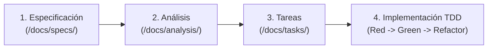

# Flujo de Trabajo: SDD, TDD, Gitflow, Conventional Commits y Releases

Este documento detalla la normativa técnica de desarrollo e integración continua para **Japan Travel Tools**.

---

## 1. Ciclo de Vida de Desarrollo: SDD + TDD

Toda nueva funcionalidad o modificación sigue obligatoriamente estas 4 etapas en orden:



1. **Especificación (`/docs/specs/`)**: Definir requisitos, reglas de negocio offline y criterios de aceptación en formato Gherkin.
2. **Análisis (`/docs/analysis/`)**: Definir impacto arquitectónico, modelos de dominio, entidades Room/DataStore y contratos de repositorios.
3. **Tareas (`/docs/tasks/`)**: Desglosar en pasos atómicos dentro de `docs/tasks/backlog.md`.
4. **Implementación TDD**:
   - Escribir primero el test unitario o de UI que falla (`RED`).
   - Implementar la lógica mínima en Kotlin para pasar el test (`GREEN`).
   - Refactorizar asegurando limpieza arquitectónica y todos los tests pasando (`REFACTOR`).

---

## 2. Estrategia de Ramas (Gitflow)

El repositorio utiliza **Gitflow**:

| Rama | Propósito | Origen | Destino de Merge |
| :--- | :--- | :--- | :--- |
| `main` | Código de producción / Releases publicadas (con APK) | Inicial | — |
| `develop` | Rama principal de integración de desarrollo | `main` | — |
| `feature/<nombre>` | Desarrollo de nuevas especificaciones o herramientas | `develop` | `develop` |
| `release/<version>` | Preparación de versión, actualización de Changelog y versión Gradle | `develop` | `main` y `develop` |
| `hotfix/<nombre>` | Correcciones críticas sobre una versión publicada | `main` | `main` y `develop` |

---

## 3. Estándar de Commits (Conventional Commits v1.0.0)

Seguimos estrictamente [Conventional Commits v1.0.0](https://www.conventionalcommits.org/en/v1.0.0/):

### Formato
```text
<type>(<optional scope>): <description>

[optional body]

[optional footer(s)]
```

### Ejemplos válidos en este repositorio
- `docs(spec): define initial SDD specifications for core, clock, currency and vault`
- `test(currency): add failing unit tests for offline EUR to JPY conversion`
- `feat(currency): implement Frankfurter API sync and Room offline cache`
- `fix(clock): handle daylight saving time offset between Tokyo and Madrid`
- `chore(release): bump version to 0.0.1-beta.1`

---

## 4. Control de Versiones, Estado Beta y Releases con APK en GitHub

### Numeración de Versiones
- Comenzamos en la versión **`0.0.1`**.
- **Regla de versión Beta**:
  - Hasta que una herramienta esté implementada al 100%, probada con TDD, funcional en modo offline y **aprobada por el usuario**, la versión se considera **Beta** (`0.0.1-beta.1`, `0.0.1-beta.2`, etc.).
  - Una vez que las herramientas del alcance estén al 100% y aprobadas, se publica la versión estable (`0.0.1`).

### Procedimiento de Publicación en `main`
Cada vez que se realiza un merge a `main` (ya sea una versión `-beta.X` o una versión final):
1. Verificar que `README.md`, `CHANGELOG.md` y `/docs` están completamente actualizados.
2. Ejecutar todos los tests (`./gradlew testDebugUnitTest`) y generar el APK instalable (`./gradlew assembleRelease` o `assembleDebug`).
3. Crear el tag anotado en Git sobre `main`:
   ```bash
   git tag -a v0.0.1-beta.1 -m "Release v0.0.1-beta.1"
   git push origin main --tags
   ```
4. Crear la **GitHub Release** adjuntando el binario `.apk` generado:
   ```bash
   gh release create v0.0.1-beta.1 <ruta-al-apk>/japan-travel-tools-v0.0.1-beta.1.apk \
     --title "v0.0.1-beta.1" \
     --notes-file RELEASE_NOTES.md \
     --prerelease
   ```
   *(El flag `--prerelease` se utiliza para todas las versiones `-beta.X` y se omite cuando la versión es 100% final y aprobada).*
